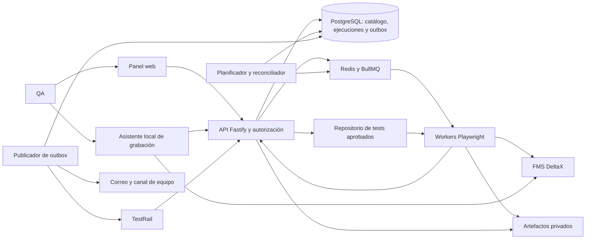

# Especificación de requerimientos — Katalyst (DeltaX QA Runner)

Nov 3, 2026 · @Kevin Subieta

**Revisión 3 — 6 de noviembre de 2026.** Un proyecto y una entrega integrada, TanStack para frontend, Terraform y un único ambiente interno de bajo costo. Reemplaza las entregas separadas de la revisión 2. Las decisiones externas aún abiertas se enumeran en sección 12; las secciones 17/18 fijan optimización e infraestructura. Arquitectura detallada en [arquitectura-deltax-qa-runner-aws.md](arquitectura-deltax-qa-runner-aws.md) y referencia visual en [LEEME de capturas](katalyst-capturas/katalyst-capturas/LEEME.md).

## 1. Propósito y alcance

Este documento especifica **DeltaX QA Runner**, una herramienta interna que reemplaza a Katalon: guarda flujos automatizados vinculados a los casos de TestRail, permite que un QA elija qué correr y los programa por día y hora. Está escrito para que otra IA lo implemente de punta a punta.

**Incluye:**

- Sincronización de casos desde TestRail y envío de resultados a TestRail.
- Suite de tests con Playwright Test vinculada a los IDs de TestRail.
- Grabación de flujos (Playwright codegen) y generación asistida por IA a partir de los pasos del caso.
- Ejecución bajo demanda y programada, con selección por caso, sección o etiqueta.
- Panel web para QA: catálogo, ejecuciones, programaciones, resultados e historial.
- Monitoreo de rendimiento basado en el script existente DXMon (tiempos, tamaños, errores, p95).

**No incluye:**

- Pruebas de carga con muchos usuarios simultáneos (se puede sumar k6 más adelante).
- Pruebas de apps móviles nativas.
- Reemplazar TestRail: TestRail sigue siendo la fuente de verdad de los casos de prueba.
- Paridad completa con Katalon: quedan fuera un IDE visual de pasos/keywords, importación automática de proyectos Katalon/Groovy, auto-reparación de selectores, matriz de navegadores/SO, pruebas de escritorio y una nube de dispositivos. El reemplazo cubre el flujo web interno descrito aquí; una migración de tests existentes requiere inventario y alcance separados.

**Cómo debe usar este documento la IA implementadora:**

1. Leer el documento completo antes de escribir código.
2. Implementar el alcance integrado de sección 11 con hitos técnicos internos. Se permite avanzar en trabajo independiente mientras se validan integraciones; no esperar aprobaciones del equipo entre bloques. No operar una función real sin resolver sus dependencias y controles. Una única aceptación final reúne la evidencia de todos los bloques.
3. Respetar los identificadores RF-xx y RNF-xx en commits, issues y tests, para poder rastrear cada requerimiento.
4. Ante una decisión no cubierta, elegir la opción más simple que cumpla el requerimiento y registrarla en `docs/decisiones.md`. Las decisiones marcadas como abiertas en la sección 12 se consultan con el equipo antes de implementarlas.
5. Nunca escribir credenciales, tokens ni datos de clientes en el código, los logs o los reportes.

## 2. Contexto

La aplicación bajo prueba es **FMS DeltaX**: frontend React (MUI + Inovua DataGrid) en `https://cbc.deltax.la` y API en `https://fmsapi.deltax.la`. El login usa AWS Cognito y el frontend envía `Authorization: Bearer <idToken>` a la API. Los casos de prueba ya viven en **TestRail**.

**Pantallas y servicios principales (ya relevados):**

| Pantalla | Ruta | Servicios que llama |
| --- | --- | --- |
| Página principal (Informe operativo) | `/controlCenterShipper` | `users/api/users/current`, `place`, `setting/i18n`, `notification/user`, `dashboard/powerBi/token`, `dashboard/shippingOrderIds` |
| Órdenes de carga (pestañas Abastecimiento, Directa, Distribuidores) | `/loadOrder` | `travelUploader/api/travelUploader/cbc/loadingOrder` y `.../filter` (parámetro `typeOperation` = `catering`, `direct`, `distribution`) |
| Instalaciones · Configuración | `/warehouses` | `warehouse/api/warehouse` |
| Instalaciones · Agendamientos (lista y calendario) | `/schedulings` | `warehouse/api/warehouse/list/scheduling`, `.../list/filter/scheduling`, `.../scheduling/status` |

**Lo que ya existe y debe reutilizarse:**

- `deltax_monitor.js` (DXMon v3): script que corre dentro de la página. Recorre las pantallas, carga la raíz en un iframe oculto y vuelve a llamar los GET aprendidos. Mide tiempos, tamaños, compresión, errores y la espera por `current`, y guarda en IndexedDB. Expone `DXMon.start/stop/summary/mark`.
- `run_dxmon.js`: ejecutor con Playwright que abre Chrome con perfil persistente, inyecta DXMon, lo reinyecta si la página se recarga y guarda `summary.json` y `samples.json`.

**Dependencia por verificar:** estos dos scripts se describen como existentes, pero no estaban presentes en la carpeta revisada al preparar esta revisión. Antes de integrar DXMon se debe obtener su código, versión/hash, condiciones de uso y muestras anonimizadas de ambos JSON. Los hallazgos siguientes son antecedentes reportados, no mediciones verificadas por esta especificación.

**Hallazgos que la herramienta debe poder detectar de forma continua:**

- `current` pesa 1,2 MB y bloquea el arranque; desde el 29/10 viaja comprimido (\~150 KB).
- Los datos de Agendamiento crecen durante el día (hasta 586 KB sin comprimir) y la lista llegó a no cargar en 60 s.
- El frontend corta llamadas a los 20 s (filtros) y a los 30 s (`current`, con 3 reintentos).
- Despliegues de frontend sin el backend correspondiente dejaron la app caída 47 minutos.
- La API no envía `Timing-Allow-Origin`: el navegador no expone DNS, conexión ni TLS.
- Una pestaña en segundo plano infla las mediciones; el ejecutor debe correr con los temporizadores sin frenar.

## 3. Actores y roles

Hay tres roles de usuario y dos actores de sistema. Los permisos se asignan por rol (RF-USR).

| Actor | Tipo | Qué hace | Permisos |
| --- | --- | --- | --- |
| QA | Usuario | Elige casos o suites, ejecuta, programa, graba flujos, revisa resultados | Ejecutar, programar, grabar, ver; no administra ambientes ni secretos |
| Desarrollador / automatizador | Usuario | Revisa y mantiene el código de los tests, aprueba tests generados o grabados | Todo lo de QA + aprobar tests y fusionar cambios en el repositorio |
| Administrador | Usuario | Configura TestRail, ambientes, usuarios de prueba, notificaciones y usuarios del panel | Todo |
| TestRail | Sistema externo | Fuente de verdad de proyectos, suites, secciones y casos; recibe corridas y resultados | Acceso por API con usuario y API key de servicio |
| Ejecutor (worker) | Sistema interno | Corre Playwright en contenedores, sube resultados y artefactos | Lee secretos del ambiente en tiempo de ejecución; no tiene acceso al panel |

## 4. Arquitectura

El QA opera desde el panel web y usa el asistente local para grabar; el backend guarda el catálogo, programa las corridas y las pone en una cola, y los workers corren Playwright contra DeltaX y devuelven resultados al backend, que los publica en TestRail mediante outbox.



Los tests viven en un repositorio git, no en la base de datos: el grabador produce archivos de test que se revisan y fusionan como código. Los workers devuelven resultados al backend por su API.

**Stack obligatorio:**

| Componente | Tecnología | Notas |
| --- | --- | --- |
| Lenguaje | TypeScript en el código nuevo | Node.js en una versión LTS con soporte vigente al iniciar; fijar versión exacta y matriz compatible en el repositorio. DXMon legado puede permanecer en JavaScript |
| Tests | Playwright Test | Un proyecto por ambiente; navegador Chromium |
| Backend | Fastify + Zod para validar entradas | API REST; documentación OpenAPI generada |
| Base de datos | PostgreSQL 15+ con Prisma | Migraciones versionadas |
| Cola y programador | Redis + BullMQ, con API Job Schedulers de la versión fijada | Cron y zona IANA; reconciliación de ocurrencias desde PostgreSQL según sección 13.5 |
| Panel | React + Vite + TypeScript, Tailwind + shadcn/ui + Lucide | Identidad DeltaX/Katalyst de las 26 capturas; sin MUI ni Inovua en este panel |
| Estado y navegación | TanStack Query + Router + Form; Store para UI compartida cuando se necesite | Contrato de propiedad de estado y caché en sección 17 |
| Tablas y gráficos | TanStack Table; Virtual bajo medición; Recharts | Paginación/filtro/sort del servidor, gráficos con agregados |
| Grabador local | Electron + React/TypeScript + Playwright codegen | Windows 11; sin Node en renderer, aislamiento de contexto y protocolo local seguro |
| Workers | Imagen oficial `mcr.microsoft.com/playwright` | Fijar tag y digest compatibles con la versión exacta del paquete Playwright; no usar `latest` |
| Artefactos | S3 privado; MinIO solo para desarrollo local | Evidencia sanitizada y lifecycle; backups/state separados |
| Despliegue | EC2 x86_64 On-Demand + Docker Compose + Caddy | Un solo ambiente `internal`; PostgreSQL/Redis persistentes en host, límites de recursos |
| Infraestructura | Terraform + provider AWS | Estado S3 privado/versionado con locking; sin CDK; sección 18 |
| Workspace y verificación | pnpm workspaces, Vitest, Testing Library, Playwright | TypeScript estricto, lockfiles y versiones estables compatibles |

La base usa workers propios en el host interno; CI construye/verifica/despliega aplicación, no sustituye al ejecutor programado. Retirar la alternativa transitoria de ejecución por CI evita mantener dos orquestadores para una entrega única. Región, tamaño definitivo, presupuesto y plataforma Git siguen pendientes de datos del equipo.

PostgreSQL es la fuente de verdad del estado y entregas pendientes; Redis es transporte reconstruible. Workers cumplen resultados, autenticación, cancelación, versiones e idempotencia de sección 13. No instalar dependencias ni ejecutar código de tests dentro del backend: incluso listar tests importa código; usar contenedor aislado sin secretos sobre commit permitido. Un único ambiente de Katalyst no elimina los destinos de DeltaX, que son registros de configuración y no despliegues nuevos de esta herramienta.

## 5. Requerimientos funcionales

Prioridad: **Debe** = obligatorio en la entrega integrada; **Debería** = esperado salvo ajuste explícito de alcance registrado; **Puede** = opcional. Los bloques indican organización de trabajo.

Las columnas `Bloque` conservan el orden técnico histórico (1 base, 2 operación/monitoreo/grabación, 3 IA/mejoras), no fechas de lanzamiento ni permisos para recortar la entrega final. Todo Debe es obligatorio en la entrega única. Debería/Puede solo se excluye mediante decisión de alcance registrada; no se presenta como funcionalidad entregada.

### 5.1 TestRail (RF-TR)

| ID | Requerimiento | Prioridad | Bloque |
| --- | --- | --- | --- |
| RF-TR-01 | Configurar y probar conexión a TestRail (URL, usuario de servicio, referencia a API key, proyecto, suite) por API administrativa en bloque 1 y desde el panel en bloque 2 | Debe | 1 |
| RF-TR-02 | Sincronizar proyectos, suites, secciones y casos (ID, título, pasos, resultado esperado, prioridad, tipo, referencias) a la base de datos, bajo demanda y cada hora | Debe | 1 |
| RF-TR-03 | Vincular cada test automatizado con uno o más IDs de caso (`C1234`) y mostrar qué casos tienen automatización y cuáles no | Debe | 1 |
| RF-TR-04 | Crear corrida de TestRail por suite con solo los casos seleccionados, publicar agregados finales y cerrar tras sincronización; ante indisponibilidad, diferir publicación sin bloquear ejecución local, según 13.4 | Debe | 1 |
| RF-TR-05 | Adjuntar error sanitizado, duración, enlace autenticado al detalle permanente de ejecución y captura sanitizada en fallas cuando esté permitida; registrar ausencia de evidencia según política del ambiente | Debe | 1 |
| RF-TR-06 | Permitir ejecutar un Test Plan o una corrida ya existente de TestRail | Debería | 2 |
| RF-TR-07 | Versionar contenido relevante del caso al sincronizar; marcar vínculos como `requiere_revision` si cambian pasos o resultado esperado. Archivar casos desaparecidos solo tras sincronización completa exitosa | Debe | 1 |
| RF-TR-08 | Mantener publicación durable, ordenada y reconciliable a TestRail, independiente del estado de ejecución; mostrar entregas pendientes y fallas de sincronización | Debe | 1 |

### 5.2 Catálogo de tests (RF-CAT)

| ID | Requerimiento | Prioridad | Bloque |
| --- | --- | --- | --- |
| RF-CAT-01 | Leer los tests del repositorio (lista de Playwright Test) con su archivo, título, etiquetas y IDs de TestRail | Debe | 1 |
| RF-CAT-02 | Filtrar por sección de TestRail, etiqueta (`@oc`, `@agendamiento`, `@arranque`, `@rendimiento`, `@humo`), estado del último resultado y texto | Debe | 2 |
| RF-CAT-03 | Guardar **suites** con nombre: conjunto de casos o etiquetas reutilizable (por ejemplo "Humo diario", "Regresión OC") | Debe | 2 |
| RF-CAT-04 | Marcar tests como inestables (flaky) según su historial y permitir excluirlos de una ejecución | Debería | 2 |
| RF-CAT-05 | Identificar cada test mediante UUID explícito y estable en metadatos versionados; títulos, rutas e IDs de Playwright son atributos, no identidad histórica | Debe | 1 |

### 5.3 Grabación y generación (RF-GRB)

| ID | Requerimiento | Prioridad | Bloque |
| --- | --- | --- | --- |
| RF-GRB-01 | Desde un caso, **Grabar** inicia un asistente local instalado que abre Chromium/codegen y prepara la sesión localmente; el panel nunca entrega `storageState` ni credenciales de ejecución | Debe | 2 |
| RF-GRB-02 | Al cerrar el grabador, crear el archivo de test con el ID del caso en el título y las etiquetas elegidas, en una rama nueva, y abrir un pull/merge request | Debe | 2 |
| RF-GRB-03 | Generar un borrador de test con IA a partir de los pasos y resultados esperados del caso de TestRail, siguiendo las convenciones de la sección 10 | Debería | 3 |
| RF-GRB-04 | Revisión asistida: la IA limpia una grabación (selectores estables, esperas por condición en lugar de tiempos fijos, datos parametrizados, verificaciones faltantes) | Debería | 3 |
| RF-GRB-05 | Solo tests aprobados, fusionados en la rama protegida e incluidos en un manifiesto validado pueden ejecutarse normalmente. Borradores solo pueden validarse en staging mediante un flujo aislado de revisión | Debe | 2 |
| RF-GRB-06 | El asistente permite iniciar, detener, descartar y enviar grabación, agregar verificaciones soportadas por codegen y mostrar pasos/verificaciones pendientes antes del PR; no promete convertir cualquier interacción en un test válido | Debe | 2 |

### 5.4 Ejecución (RF-EJE)

| ID | Requerimiento | Prioridad | Bloque |
| --- | --- | --- | --- |
| RF-EJE-01 | Ejecutar bajo demanda selección de casos o etiquetas en bloque 1; suites guardadas desde bloque 2. Elegir ambiente y reintentos (0 a 2, por defecto 0); Chromium es el único navegador admitido | Debe | 1 |
| RF-EJE-02 | Mostrar el avance en vivo: en cola, corriendo, pasados, fallidos, omitidos | Debe | 2 |
| RF-EJE-03 | Cancelar una ejecución en curso | Debe | 2 |
| RF-EJE-04 | Paralelizar entre N workers configurables y limitar la concurrencia por ambiente | Debe | 2 |
| RF-EJE-05 | Reintentar fallas funcionales hasta N veces (0..2) y marcar inestable si pasa tras retry; escritura sin idempotencia aprobada no se reintenta, según 13.3 | Debe | 1 |
| RF-EJE-06 | En producción permitir solo tests aprobados con clasificación explícita `lectura`, revisión vigente y usuario de permisos de lectura; bloquear escritura, clasificación ausente o contradictoria. `@escritura` es una etiqueta derivada de la clasificación, no el único control | Debe | 1 |
| RF-EJE-07 | Congelar selección, vínculos de casos, versiones de casos, commit, parámetros y política de ejecución al aceptar una corrida; mostrar su plan resuelto y motivos de bloqueo | Debe | 1 |
| RF-EJE-08 | Persistir intentos, leases y resultados de forma idempotente; recuperar fallos de infraestructura y distinguirlos de fallas de la aplicación según sección 13 | Debe | 1 |

### 5.5 Programación (RF-PRG)

| ID | Requerimiento | Prioridad | Bloque |
| --- | --- | --- | --- |
| RF-PRG-01 | Crear programaciones de casos/etiquetas en bloque 1 y suites guardadas desde bloque 2: ambiente, días, hora o rango con intervalo (por ejemplo lunes a viernes 08:00–18:00 cada 30 min) y zona horaria | Debe | 1 |
| RF-PRG-02 | Editor visual de horario que genere la expresión cron y muestre las próximas 5 ejecuciones | Debe | 2 |
| RF-PRG-03 | Pausar, reanudar, duplicar y borrar programaciones; historial de cambios con autor | Debe | 2 |
| RF-PRG-04 | Admitir como máximo una ejecución activa o en cola por programación; registrar cada ocurrencia solapada como omitida con motivo, sin acumular trabajo atrasado | Debe | 1 |
| RF-PRG-05 | Ventanas de exclusión (por ejemplo, durante un despliegue) | Puede | 3 |

### 5.6 Resultados y reportes (RF-RES)

| ID | Requerimiento | Prioridad | Bloque |
| --- | --- | --- | --- |
| RF-RES-01 | Guardar por ejecución: estado, duración, test, caso de TestRail, error, reintentos, ambiente, commit del repositorio y quién la inició | Debe | 1 |
| RF-RES-02 | Guardar evidencia sanitizada permitida por ambiente (reporte, traza, video y captura en fallas); acceso autenticado por API desde bloque 1 y panel desde bloque 2. Registrar artefactos deshabilitados, fallidos o retenidos por seguridad | Debe | 1 |
| RF-RES-03 | Historial por test y por caso con tendencia de éxito y duración | Debe | 2 |
| RF-RES-04 | Exportar resultados a CSV y PDF | Debería | 2 |
| RF-RES-05 | Mostrar resultados por intento, test y caso, cobertura parcial, causa de omisión y estado de publicación a TestRail sin confundir estas dimensiones | Debe | 1 |

### 5.7 Monitoreo de rendimiento (RF-REN)

| ID | Requerimiento | Prioridad | Bloque |
| --- | --- | --- | --- |
| RF-REN-01 | Integrar DXMon como suite `@rendimiento`: por cada ciclo, tiempos de pantallas, arranque de la raíz (espera por `current`) y GET aprendidos, con tamaño en red y descomprimido | Debe | 2 |
| RF-REN-02 | Panel de rendimiento: promedio, p95 y máximo por pantalla y servicio, por hora y por día, con comparación entre períodos | Debe | 2 |
| RF-REN-03 | Umbrales configurables por pantalla o servicio (por ejemplo p95 de Agendamientos lista > 10 s) que generan alerta | Debe | 2 |
| RF-REN-04 | Marcar eventos (despliegues) en la línea de tiempo para comparar antes y después | Debería | 2 |
| RF-REN-05 | Contar aparte errores HTTP, timeouts y respuestas de más de 29 s con su hora exacta | Debe | 2 |

### 5.8 Notificaciones (RF-NOT)

| ID | Requerimiento | Prioridad | Bloque |
| --- | --- | --- | --- |
| RF-NOT-01 | Notificar por al menos un canal elegido por el equipo (correo, Slack o Teams) al terminar con fallas o interrupción; resumen y enlace autenticado. Otros canales son ampliaciones independientes | Debe | 2 |
| RF-NOT-02 | Notificar cuando se supera un umbral de rendimiento (RF-REN-03), sin repetir la misma alerta más de una vez por hora | Debe | 2 |
| RF-NOT-03 | Cada usuario elige qué programaciones y alertas recibe | Debería | 3 |

### 5.9 Ambientes, usuarios de prueba y acceso (RF-AMB, RF-USR)

| ID | Requerimiento | Prioridad | Bloque |
| --- | --- | --- | --- |
| RF-AMB-01 | Registrar ambientes (nombre, URL de app, URL de API, si es producción) | Debe | 1 |
| RF-AMB-02 | Registrar usuarios de prueba por ambiente; las contraseñas se guardan cifradas o en un gestor de secretos y solo el worker las lee | Debe | 1 |
| RF-AMB-03 | Autenticar y validar sesión con identidad/ambiente esperados antes de cada ejecución; crear `storageState` aislado por ejecución/usuario, nunca compartir perfiles persistentes y borrar al terminar o recuperar un worker caído | Debe | 1 |
| RF-USR-01 | Login al panel (correo y contraseña o SSO de la empresa) con los roles de la sección 3 | Debe | 2 |
| RF-USR-02 | Registro de auditoría desde bloque 1: quién ejecutó, programó, aprobó o cambió configuraciones; consulta visual desde bloque 2 | Debe | 1 |
| RF-USR-03 | Autenticar API desde bloque 1 mediante identidad administrativa inicial y tokens revocables con permisos; workers con credencial propia de alcance restringido y expirable | Debe | 1 |

## 6. Requerimientos no funcionales

| ID | Categoría | Requerimiento |
| --- | --- | --- |
| RNF-SEG-01 | Seguridad | Ningún secreto de DeltaX/TestRail (API keys, contraseñas, tokens del sistema bajo prueba, `storageState`) en repositorio, logs, reportes ni respuestas de API. Secretos en entorno/gestor; estado autenticado temporal se borra al terminar. Solo endpoints dedicados de autenticación pueden emitir credenciales propias del panel/dispositivo, por HTTPS y sin logs, nunca mediante catálogos/reportes |
| RNF-SEG-02 | Seguridad | Sanitizar reportes, URLs, DOM, cuerpos y adjuntos según sección 13.7; bloquear publicación de evidencia que no pueda sanitizarse. No basta enmascarar encabezados |
| RNF-SEG-03 | Seguridad | API protegida desde bloque 1; panel con login desde bloque 2. HTTPS en toda exposición de red; loopback local de desarrollo exceptuado. Validación de esquemas y autorización por recurso en cada ruta |
| RNF-SEG-04 | Seguridad | Los tests en producción solo leen datos (RF-EJE-06); los de escritura corren en un ambiente de pruebas |
| RNF-REN-01 | Rendimiento | Con 5.000 casos y 10 usuarios concurrentes, p95 de las API de listado < 1 s en ensayo de 5 min, excluyendo red externa; páginas de hasta 100 filas. Registrar recursos de la VM y plan de ensayo |
| RNF-REN-02 | Rendimiento | Registrar ocurrencia programada en <= 60 s con servicios disponibles; iniciar navegador en <= 60 s solo cuando existe capacidad reservada. Medir por separado retraso de admisión y de inicio; saturación se muestra explícitamente |
| RNF-CON-01 | Confiabilidad | Detectar caída por lease vencido en <= 90 s; invalidar al worker anterior y recuperar una sola vez según sección 13.3. Escrituras de resultado desconocido no se repiten automáticamente |
| RNF-CON-02 | Confiabilidad | Si TestRail no responde, los resultados se guardan localmente y se reenvían con reintentos exponenciales hasta 24 h |
| RNF-CON-03 | Confiabilidad | Los navegadores corren sin freno de temporizadores en segundo plano (`--disable-background-timer-throttling`, `--disable-renderer-backgrounding`, `--disable-backgrounding-occluded-windows`) |
| RNF-OBS-01 | Observabilidad | Logs estructurados en JSON con ID de ejecución; métricas de cola (pendientes, duración, fallas) |
| RNF-MAN-01 | Mantenibilidad | Pruebas unitarias del backend con cobertura mínima del 70 % en servicios de TestRail, programación y resultados |
| RNF-MAN-02 | Mantenibilidad | `README` con instalación en servidor limpio en < 30 min con Docker Compose una vez disponibles DNS/TLS, credenciales, acceso de red y recursos acordados; documentar estos prerrequisitos y verificar con instalación reproducida |
| RNF-USA-01 | Usabilidad | El panel está en español; fechas y horas en la zona configurada (por defecto `America/La_Paz`) |
| RNF-USA-02 | Usabilidad | Un QA sin conocimientos de programación puede ejecutar, programar y revisar resultados sin tocar código ni la terminal |
| RNF-SEG-05 | Seguridad | Artefactos privados; URLs firmadas de máximo 5 min tras autorización. Contenedores de tests sin acceso al socket Docker, secretos del backend ni metadatos de nube |
| RNF-CON-04 | Confiabilidad | Backup diario cifrado de PostgreSQL, retención 7 días, RPO <= 24 h y RTO objetivo <= 4 h; demostrar restauración antes de operar en producción. Persistencia Redis y reconciliación desde BD |
| RNF-OBS-02 | Observabilidad | Health/liveness y readiness sin secretos; readiness refleja BD/cola. Métricas de retraso, leases vencidos, outbox pendiente, almacenamiento y última sincronización exitosa |
| RNF-OPT-01 | Estado | Propiedad única de estado según sección 17: Query remoto, Router URL, Form borradores, React/Store UI; sin duplicar entidades ni persistir tokens en navegador |
| RNF-OPT-02 | Tablas | TanStack Table con paginación/filtros/sort de servidor, 25 filas por defecto y máximo 100; selección por IDs estable, alcance entre páginas explícito y accesibilidad por teclado |
| RNF-OPT-03 | Frontend | JS inicial <= 250 KiB gzip, excluyendo rutas diferidas; gráficos, visor de código y reportes fuera del chunk inicial. Evidencia de build y perfil con 5.000 casos |
| RNF-OPT-04 | Red | Una sola consulta/caché por clave y canal SSE por pestaña autenticada; fallback limitado, búsquedas con debounce y cancelación; sin polling de corridas terminales o pestañas ocultas |
| RNF-OPT-05 | Backend | Consultas paginadas/proyectadas sin N+1; pool PostgreSQL total <= 20 conexiones iniciales y concurrencia global de navegadores 1, ajustables solo tras ensayo de capacidad |
| RNF-INF-01 | Infraestructura | Terraform administra un ambiente `internal` conforme a sección 18; root/estado único de aplicación, versiones bloqueadas y secretos fuera de state/configuración |
| RNF-INF-02 | Costos | Estimación regional con techo acordado antes de apply; presupuesto/alertas, tags y retenciones; no Free Tier como supuesto ni ahorro porcentual sin medición |
| RNF-INF-03 | Operación | Host único sin HA con backup/restauración probados; límites CPU/RAM/disco y alertas externas, sin Spot para datos persistentes ni apagados incompatibles con cron |

## 7. Modelo de datos

Entidades mínimas en PostgreSQL. Todas llevan `id` (UUID), `created_at` y `updated_at`; los nombres de columnas van en `snake_case`.

| Entidad | Campos principales | Relaciones |
| --- | --- | --- |
| `testrail_connection` | `base_url`, `username`, `secret_ref`, `enabled`, `last_sync_at`, `last_sync_status` | Configuración administrativa, nunca contiene API key en claro |
| `testrail_project`, `testrail_suite` | `connection_id`, ID externo, `name`, `archived_at` | Suite pertenece a proyecto; sección pertenece a suite |
| `testrail_case` | `tr_case_id`, `section_id`, `title`, `steps` (JSON), `expected`, `priority`, `type`, `refs`, `content_hash`, `revision`, `archived_at`, `synced_at` | Pertenece a sección; contenido histórico en `case_revision` |
| `case_revision` | `case_id`, `revision`, `content_hash`, `content` (JSON sanitizado) | Inmutable; historial para snapshots y revisiones |
| `testrail_section` | `tr_section_id`, `suite_id` (FK local), `name`, `parent_id`, `depth` | Árbol de secciones; ID externo de suite en `testrail_suite` |
| `automated_test` | `stable_key` (UUID en Git), `file_path`, `title`, `tags` (texto[]), `classification` (`lectura`, `escritura`, `sin_clasificar`), `status` (`borrador`, `aprobado`, `retirado`), `flaky_score`, `manifest_commit` | N a N con casos exclusivamente mediante `test_case_link` |
| `test_case_link` | `automated_test_id`, `case_id`, `reviewed_case_revision`, `review_status`, `reviewed_by`, `reviewed_at` | Revisión pendiente impide producción y programaciones; staging manual muestra advertencia |
| `suite` | `name`, `description`, `selector` (JSON: casos, etiquetas, secciones) | Reutilizada por `run` y `schedule` |
| `environment` | `name`, `app_url`, `api_url`, `is_production`, `max_concurrency` | Tiene `test_user` |
| `test_user` | `environment_id`, `label`, `username`, `secret_ref` (referencia al secreto, nunca el valor) | Pertenece a `environment` |
| `schedule` | `name`, `suite_id` opcional, `selector` (JSON), `environment_id`, `cron_expressions` (texto[]), `timezone`, `window_start`, `window_end`, `enabled`, `retries`, `notify` (JSON), `revision`, `created_by`, `deleted_at` | Selector por suite/casos/etiquetas; borrado lógico conserva historial |
| `schedule_occurrence` | `schedule_id`, `schedule_revision`, `scheduled_for`, `status` (`admitida`, `omitida`), `reason`, `run_id` opcional | Una por instante UTC; incluye ocurrencias omitidas por caída, solapamiento o capacidad |
| `run` | `trigger` (`manual`, `programada`, `api`), `suite_id` opcional, `schedule_id` opcional, `environment_id`, `status`, `outcome`, `sync_status`, `selection_snapshot` (JSON inmutable), `scheduled_for`, `queued_at`, `started_at`, `finished_at`, `cancel_requested_at`, `git_commit`, `runtime_versions` (JSON), `created_by`, `idempotency_key` | Tiene resultados y artefactos; IDs externos solo en `run_testrail_target` |
| `run_testrail_target` | `run_id`, `testrail_suite_id` (FK local), `tr_run_id`, `sync_status`, `close_existing_run` | Un destino por corrida local/suite; evita duplicar ID externo en `run` |
| `run_shard` | `run_id`, `shard_key`, `status`, `assigned_test_keys` (JSON) | Partición de trabajo disjunta; bloque 1 usa un único shard, bloque 2A permite N |
| `run_result` | `run_id`, `automated_test_id`, `parameter_key`, `status`, `reason`, `duration_ms`, `retry_count`, `infra_recovery_count` | Resultado final por test/variante; sin `tr_case_id` duplicado |
| `test_attempt` | `run_result_id`, `attempt_no`, `kind` (`inicial`, `retry`, `recuperacion`), `status`, `started_at`, `finished_at`, `duration_ms`, `error_category`, `error`, `worker_lease_id` | Evidencia por intento |
| `case_result` | `run_id`, `case_id`, `case_revision`, `status`, `coverage` (`completa`, `parcial`, `ninguna`), `contributing_results` (JSON), `duration_ms`, `tr_result_id` | Agregado publicable a TestRail |
| `worker_lease` | `run_shard_id`, `worker_id`, `generation`, `heartbeat_at`, `expires_at`, `revoked_at` | Lease por shard, no global por corrida; admite workers paralelos sin invalidarse entre sí |
| `outbox_delivery` | `run_id` opcional, `operation`, `dedup_key`, `payload` sanitizado, `status`, `attempts`, `next_attempt_at`, `expires_at`, `external_id`, `last_error` | Cola durable transaccional para ejecución, TestRail y notificaciones; alertas pueden no pertenecer a una corrida |
| `recording_session` | `case_id`, `environment_id`, `created_by`, `device_id`, `status`, `expires_at`, `branch`, `pr_url`, `commit` | Nunca contiene sesiones de navegador ni contraseñas |
| `artifact` | `run_id`, `run_result_id` opcional, `test_attempt_id` opcional, `kind`, `storage_key`, `size_bytes`, `checksum`, `sanitization_status`, `expires_at` | Solo evidencia sanitizada es publicable |
| `perf_sample` | `run_id`, `ts`, `source` (`ui`, `raiz`, `probe`, `app`), `endpoint`, `status_code`, `ok`, `total_ms`, `ttfb_ms`, `download_ms`, `bytes_wire`, `bytes_body`, `timeout`, `over_29s`, `visible` | Importado del `samples.json` de DXMon |
| `perf_threshold` | `environment_id`, `series_selector` (JSON: endpoint/pantalla, origen, tipo de métrica, caché y perfil), `metric` (`p95`, `max`, `error_rate`, `timeout_rate`), `limit`, `window_min`, `min_samples`, `enabled` | Dispara `alert`; selector de una sola serie y unidades explícitas |
| `event_mark` | `ts`, `label`, `environment_id`, `created_by` | Despliegues y cambios |
| `alert` | `kind`, `environment_id`, `threshold_id`, `fingerprint`, `payload` (JSON), `status`, `last_sent_at`, `channel` | Intentos de envío en outbox; deduplicación persistente |
| `audit_log` | `actor`, `action`, `entity`, `entity_id`, `diff` (JSON) | — |
| `panel_user` | `email`, `name`, `role` (`qa`, `dev`, `admin`), `auth_subject`, `password_hash` opcional, `disabled_at` | Hash solo si se elige autenticación propia |
| `api_credential` | `principal_id`, `kind`, `token_hash`, `scopes`, `expires_at`, `revoked_at` | Nunca almacena token recuperable |

Restricciones mínimas: unicidad de IDs externos por conexión y tipo; de `stable_key`; de `(automated_test_id, case_id)` en vínculos; de `(schedule_id, scheduled_for)`; de `(run_id, automated_test_id, parameter_key)`; de `(run_result_id, attempt_no)`; de `(run_id, case_id)`; de `(run_id, testrail_suite_id)`; de `(run_id, shard_key)`; y de `outbox_delivery.dedup_key`. `parameter_key` no nulo, valor `default` para tests sin parámetros. Como máximo un lease vigente por shard y un propietario activo por test/variante. FKs para todas las relaciones; `parent_id` de sección apunta al UUID local y debe pertenecer a la misma suite. Correos normalizados únicos. No borrar físicamente casos, usuarios, tests ni ambientes referenciados por historial.

Extensiones de `perf_sample`: `environment_id`, `sample_key` único por ejecución, `schema_version`, `endpoint_key` normalizado, `screen_key`, `metric_kind`, `cache_mode`, `worker_profile`, `censored`, `invalid_reason`. Tiempos/tamaños no disponibles son `null`, nunca cero inventado. Índice compuesto `(environment_id, endpoint_key, source, ts)`. Retener muestras crudas 90 días; bloque 2 usa borrado por lotes y resúmenes horarios durante 365 días; particionar solo tras justificarlo con mediciones. No calcular p95 diario promediando p95 horarios: consultar muestras crudas; fuera de 90 días mostrar únicamente métricas conservadas y p95 diario como no disponible, salvo que se implemente un sketch combinable validado.

Retención inicial: resultados, auditoría y entregas terminales 365 días; artefactos sanitizados 30 días; código local sanitizado de grabación hasta envío/cancelación, máximo 24 h. Sesiones autenticadas locales se eliminan al cerrar/cancelar o vencer a las 2 h, según 13.6. Limpieza diaria idempotente sin eliminar objetos de ejecuciones activas; la UI informa expiración. `perf_hourly_aggregate` conserva dimensiones, conteo, sumas, mínimo/máximo y conteos de errores/timeouts, sin URL cruda ni datos personales. Todos los instantes se guardan como UTC (`timestamptz`) y se presentan en zona configurada.

## 8. Integración con TestRail

Se usa la API REST v2 de TestRail con autenticación básica (usuario de servicio + API key) y `Content-Type: application/json`. La IA implementadora debe verificar cada llamada contra la documentación de la versión de TestRail que use el equipo antes de codificarla.

| Para qué | Llamada | Notas |
| --- | --- | --- |
| Listar proyectos y suites | `GET get_projects`, `GET get_suites/{project_id}` | Para la pantalla de configuración |
| Secciones | `GET get_sections/{project_id}&suite_id={id}` | Construir el árbol |
| Casos | `GET get_cases/{project_id}&suite_id={id}` | Respuesta paginada (`offset`, `limit`, enlace `next`): recorrer todas las páginas |
| Crear corrida | `POST add_run/{project_id}` con `suite_id`, `name`, `include_all: false`, `case_ids` | Nombre: `QA Runner · <suite> · <ambiente> · <fecha hora>` |
| Enviar resultados | `POST add_results_for_cases/{run_id}` con `results: [{case_id, status_id, comment, elapsed}]` | Enviar en lotes de hasta 100 |
| Adjuntar evidencia | `POST add_attachment_to_result/{result_id}` (multipart) | Solo captura en fallas; el resto queda como enlace |
| Cerrar corrida | `POST close_run/{run_id}` | Tras reconciliar resultados y adjuntos, según 13.4 |
| Usar un plan existente | `GET get_plan/{plan_id}`, `GET get_tests/{run_id}` | Bloque 2 (RF-TR-06) |

**Mapeo de estados:**

| QA Runner | TestRail `status_id` |
| --- | --- |
| pasado | 1 (Passed) |
| inestable (pasó en un reintento) | 1 (Passed), con comentario "pasó en el reintento N" |
| fallido | 5 (Failed) |
| omitido, cobertura parcial o bloqueado por política de producción | 2 (Blocked), con causa explícita |
| no ejecutado (cancelado) | no se envía resultado |

**Reglas:**

- Un test puede cubrir varios casos (`C101 C102` en el título); una selección por caso ejecuta el test completo, pero publica solo los casos seleccionados. Mostrar los otros casos tocados como información. Si un test mezcla pasos de lectura y escritura se clasifica completo como escritura.
- Un caso con varios tests se agrega según sección 13.4; nunca se publica Passed para cobertura incompleta.
- Respetar los límites de la API: ante HTTP 429 esperar lo que indique `Retry-After`.
- **Atajo condicionado para bloque 1:** `trcli` solo si una prueba de compatibilidad demuestra preservación de IDs existentes, selección, agregación, adjuntos y recuperación sin crear casos nuevos ni duplicar corridas. JUnit no sustituye el contrato de resultados internos. Ante incompatibilidad usar adaptador API.
- La sincronización recorre todas las páginas en staging transaccional; un fallo no archiva casos ni reemplaza el catálogo por una lista parcial. Adaptar campos personalizados y pasos al esquema real de TestRail, y registrar campos no soportados sin descartar silenciosamente verificaciones.
- Crear una corrida externa por suite de TestRail; una selección que abarque varias suites se divide bajo una ejecución local mediante `run_testrail_target` y resultados enrutados al destino correcto. Los planes/corridas existentes no se cierran automáticamente sin una opción explícita; nunca cambiar su selección sin permiso administrativo.

## 9. API del backend

API REST bajo `/api/v1`, JSON, autenticada con sesión o token del panel. Los workers usan un token de servicio propio. Toda respuesta de error sigue `{ error: { code, message } }`.

| Método y ruta | Para qué | Rol mínimo |
| --- | --- | --- |
| `POST /testrail/sync` | Sincronizar casos ahora (RF-TR-02) | admin |
| `GET /testrail/cases?section=&q=&automated=` | Catálogo de casos con estado de automatización | qa |
| `GET /tests?tag=&case=&status=` | Tests automatizados del repositorio | qa |
| `POST /tests/refresh` | Releer el repositorio (`playwright test --list --reporter=json`) | dev |
| `GET/POST/PUT/DELETE /suites` | Suites con nombre (RF-CAT-03) | qa |
| `POST /runs` con `{ suiteId \| caseIds \| tags, environmentId, retries }` | Ejecutar ahora (RF-EJE-01) | qa |
| `GET /runs`, `GET /runs/{id}` | Lista y detalle con resultados | qa |
| `POST /runs/{id}/cancel` | Cancelar (RF-EJE-03) | qa |
| `GET /runs/{id}/events` | Avance en vivo por Server-Sent Events (RF-EJE-02) | qa |
| `GET/POST/PUT/DELETE /schedules`, `POST /schedules/{id}/pause` | Programaciones (RF-PRG) | qa |
| `GET /schedules/{id}/next?count=5` | Próximas ejecuciones | qa |
| `POST /recordings` con `{ caseId, environmentId, tags }` | Crear sesión de grabación y devolver ID, vencimiento y enlace para asistente local; sin credenciales ni `storageState` | qa |
| `POST /recordings/{id}/complete` con el código grabado | Crear rama y pull request (RF-GRB-02) | qa |
| `POST /generate` con `{ caseId }` | Borrador de test con IA (RF-GRB-03) | dev |
| `GET /perf?endpoint=&from=&to=&by=hour` | Agregados de rendimiento (RF-REN-02) | qa |
| `GET/POST /perf/thresholds`, `POST /events` | Umbrales y marcas de eventos | dev |
| `GET/POST/PUT /environments`, `/environments/{id}/users` | Ambientes y usuarios de prueba (nunca devuelve secretos) | admin |
| `POST /worker/results` | Los workers envían resultados y metadatos de artefactos | servicio |

Rutas adicionales obligatorias de bloque 1: `POST /testrail/connection/test`, `GET/PUT /testrail/connection` (admin, solo referencias de secretos); `POST /runs/preview` (qa, no ejecuta); `GET /runs/{id}/artifacts/{artifactId}` (qa, autorización por recurso); `POST /worker/heartbeat` y `POST /worker/artifacts/upload` (servicio, acotadas al lease); `PUT /tests/{id}/case-links/{caseId}/review` (dev, revisión de versión de caso, no aprobación de código); `POST /integrations/testrail/deliveries/{id}/retry` (admin, reconciliar antes de reenviar). Desde bloque 2: login/logout/identidad (autenticación propia), administración de usuarios (admin), `POST /recordings/{id}/cancel`, `GET /recordings/{id}`, `GET /audit-log` (admin) y estado de salud del asistente vinculado. Toda ruta listada en la tabla principal se entrega en el bloque de su RF; enumerarla no adelanta el alcance. La API del flujo de dispositivo (inicio, aprobación autenticada y consulta limitada por código) debe quedar documentada en OpenAPI antes de implementar 2C.

Contratos comunes: paginación por cursor con `limit` 1..100; selección discriminada exactamente entre `suiteId`, `caseIds` o `tags`; listas no vacías y sin duplicados; etiquetas combinadas con OR y secciones incluyen descendientes. Crear corridas exige `Idempotency-Key` por actor: misma clave y cuerpo devuelve la misma corrida; cuerpo distinto devuelve 409; retener claves 24 h. Cron inválido, IDs ajenos al proyecto, ambiente deshabilitado o selección vacía devuelven 422 con código estable y sin crear corrida externa. Casos válidos sin automatización se conservan en el plan como bloqueados. Backend resuelve commits permitidos; el cliente no puede proporcionar comandos, rutas o refs Git arbitrarios. Errores: 401 sin autenticación, 403 sin permiso, 404 inexistente/no visible, 409 conflicto, 429 límite. Respuesta de error añade `requestId` y detalles de validación sanitizados. SSE usa sesión segura y `Last-Event-ID`; reconexión entrega snapshot y eventos posteriores, sin tokens en query strings.

**Grabación en bloque 2C:** codegen corre en la computadora del QA mediante un asistente gráfico instalado una vez por soporte. El panel permite abrirlo y ver su disponibilidad sin terminal. Si no está instalado, muestra instrucciones de instalación y no promete abrir Chromium remotamente. Plataforma local obligatoria inicial: Windows 11; otros SO quedan fuera del criterio de aceptación inicial. El protocolo de vínculo se define en 13.6.

## 10. Convenciones de tests y grabación

Todo test, escrito a mano, grabado o generado por IA, debe cumplir estas reglas antes de aprobarse (RF-GRB-05).

**Estructura del repositorio de tests:**

```text
qa-tests/
  playwright.config.ts      # un project por ambiente; reporters: html, json, junit
  auth.setup.ts             # inicia sesión con el usuario de prueba y guarda storageState
  pages/                    # Page Objects: LoadOrderPage, SchedulingPage, WarehousePage...
  fixtures/                 # datos de prueba y fixtures compartidos
  tests/
    oc/                     # Órdenes de carga
    agendamiento/
    instalaciones/
    arranque/
    rendimiento/            # DXMon como test
  tools/deltax_monitor.js   # script DXMon v3 (sin modificar su lógica)
```

**Reglas:**

1. **Título con ID de TestRail y etiquetas:** `test('C1234 Abrir Órdenes de carga y ver la grilla @oc @humo', ...)`.
2. **Selectores en este orden:** `getByTestId` (`data-testid`), `getByRole` con nombre accesible, `getByLabel`, `getByText`. Prohibido usar clases CSS generadas (`css-2etuwl`) o XPath por posición.
3. **Esperas por condición:** `expect(...).toBeVisible()`, `waitForResponse`. Prohibido `waitForTimeout` salvo en el monitor de rendimiento.
4. **Al menos una verificación por paso relevante** que compruebe el resultado esperado del caso de TestRail.
5. **Sesión por `storageState`** generada en `auth.setup.ts`; ningún test escribe credenciales.
6. **Datos de prueba:** los tests `@escritura` crean datos con prefijo único `QA-AUTO-<runId>-<worker>-<uuid>` y limpieza según regla 10.
7. **Grillas Inovua DataGrid:** filas con `.InovuaReactDataGrid__row`; una grilla está lista cuando no hay `.MuiSkeleton-root`, `.MuiCircularProgress-root` ni `.InovuaReactDataGrid__load-mask--visible` visibles.
8. **Pedido al frontend:** agregar `data-testid` en pestañas, botones de vista (lista, calendario), filtros y grillas de las pantallas cubiertas.
9. **Identidad y catálogo:** manifiesto versionado con UUID estable, casos, clasificación, etiquetas y claves de parámetros. Validar unicidad, correspondencia con la lista de Playwright y ausencia de casos inventados en CI. Las etiquetas e IDs en el título son legibilidad; el manifiesto es la referencia autoritativa y las divergencias bloquean aprobación.
10. **Datos y aislamiento:** parametrización mediante fixtures tipadas sin secretos ni datos reales de clientes. `parameter_key` estable por variante; prefijo de datos `QA-AUTO-<runId>-<worker>-<uuid>`. Cleanup en `finally` y tarea de reconciliación de residuos; no borrar datos ajenos al prefijo y propietario. Reservar usuario/recurso cuando no soporte concurrencia; un contexto de navegador aislado por test no aísla datos del servidor.
11. **Verificaciones:** codegen registra acciones y permite agregar assertions; una navegación exitosa no prueba una regla de negocio. `TODO selector`, verificaciones pendientes, `.skip`/`.only` no autorizados o ausencia de clasificación impiden aprobar. Una grilla vacía puede ser correcta: comprobar estado vacío esperado o filas según fixture, no exigir siempre primera fila.
12. **Selectores compartidos:** Page Objects concentran selectores de las pantallas; las clases públicas de MUI/Inovua descritas arriba son una excepción controlada y versionada. No eliminar esas excepciones automáticamente en bloque 3; sustituir por test IDs cuando el frontend los provea.

**Ejemplo de cuerpo de test:** el manifiesto complementario debe registrar su UUID, clasificación `lectura`, caso C1234, etiquetas y fixture que garantiza al menos una fila; este fragmento por sí solo no constituye un test listo para aprobar.

```ts
import { test, expect } from '@playwright/test';

test('C1234 Abrir Órdenes de carga y cambiar a Distribuidores @oc @humo', async ({ page }) => {
  await page.goto('/loadOrder');
  await expect(page.getByRole('heading', { name: 'Órdenes de carga' })).toBeVisible();
  const respuesta = page.waitForResponse(r => r.url().includes('/cbc/loadingOrder') && r.url().includes('typeOperation=distribution'));
  await page.getByRole('button', { name: 'Distribuidores' }).click();
  expect((await respuesta).status()).toBe(200);
  await expect(page.locator('.InovuaReactDataGrid__row').first()).toBeVisible();
});
```

**Prompt base para la generación con IA (RF-GRB-03):** "Escribe un test de Playwright en TypeScript para el caso de TestRail {ID}: {título}. Pasos: {pasos}. Resultado esperado: {esperado}. Usa los Page Objects de `pages/` si existen, cumple las reglas de la sección 10 y no inventes selectores: si no conoces uno, deja `// TODO selector` y una verificación pendiente."

## 11. Entrega integrada, hitos internos y criterios de aceptación

Un único alcance y una única entrega final con panel, ejecución/programación, TestRail, monitoreo, grabación e IA acordada. Los bloques siguientes organizan dependencias y evidencia, sin entregas separadas ni aprobación del equipo entre bloques. Los componentes independientes pueden construirse concurrentemente; primero validar integraciones críticas y no declarar operativa una función con dependencia pendiente. Todos los criterios aplicables se reúnen en la aceptación final.

### Bloque 0 — Validación de dependencias y contrato de ejecución

No construye el panel ni una plataforma completa. Valida con acceso autorizado un caso real de TestRail, login en staging, ejecución Chromium y publicación de su resultado con captura sanitizada. Usa código mínimo desechable o reutilizable, sin comprometer aún la infraestructura abierta en sección 12.

- [ ] Confirmados los cuatro casos iniciales, sus IDs, resultados esperados, fixtures, permisos y selectores disponibles.
- [ ] Probado login real de Cognito, almacenamiento de sesión, expiración, renovación y eventual MFA/desafío; bloqueo documentado si requiere intervención incompatible con ejecución desatendida.
- [ ] Verificados versión/esquema/API/límites/permisos de TestRail y mapeo de estados; evidencia de un ciclo crear/publicar/adjuntar/cerrar en proyecto autorizado de prueba.
- [ ] Decisiones externas de cada integración resueltas antes de usarla; flujos Katalon a migrar inventariados si existen, sin asumir conversión automática. Trabajo local independiente no espera decisiones de despliegue.
- [ ] Recibidos o identificados como bloqueo de bloque 2B los scripts DXMon y muestras sanitizadas.

### Bloque 1 — Base funcional

**Componentes del motor:** repositorio `qa-tests` con 4 casos reales de TestRail automatizados (uno de Órdenes de carga, uno de Agendamientos, uno de Instalaciones y el arranque), backend con sincronización, ejecución bajo demanda, cron y publicación. Se verifica inicialmente por API para aislar fallas; la entrega final sí incluye panel y workers propios, sin alternativa de ejecución permanente por CI.

- [ ] RF-TR-01 a RF-TR-05, RF-CAT-01, RF-EJE-01, RF-EJE-05, RF-EJE-06, RF-PRG-01, RF-PRG-04, RF-RES-01, RF-RES-02, RF-AMB-01 a RF-AMB-03 implementados.
- [ ] Una ejecución manual de los 4 casos crea el destino de TestRail correspondiente por suite, con los 4 resultados correctos y captura sanitizada en fallas en el ambiente de prueba que la permite.
- [ ] Una programación de lunes a viernes, de 08:00 a 18:00 cada 30 min, corre a horario durante un día completo sin intervención.
- [ ] Un test con `@escritura` es bloqueado en el ambiente marcado como producción.
- [ ] Ningún secreto aparece en el repositorio, los logs ni los reportes (revisión con `gitleaks` o similar).
- [ ] RF-TR-07/08, RF-CAT-05, RF-EJE-07/08, RF-RES-05 y RF-USR-02/03 implementados; RNF de seguridad, confiabilidad, observabilidad y cobertura aplicables verificados antes de operar con datos reales.
- [ ] Duplicar `POST /runs` o callback de worker no duplica ejecución ni resultados. Mismo idempotency key con cuerpo diferente devuelve 409.
- [ ] Caída de worker antes/durante/después del resultado ejercitada; leases obsoletos rechazados y escritura de resultado desconocido no repetida.
- [ ] TestRail no disponible: ejecución local termina, entrega persiste tras reinicio y sincroniza al recuperarse; timeout ambiguo no provoca creación ciega duplicada.
- [ ] Tests sin clasificación o con revisión pendiente no acceden a producción. Una corrida bloqueada no se presenta como exitosa.
- [ ] Backup restaurado en entorno limpio; catálogo y cola de publicación recuperables. En cada despliegue, smoke test de API protegida y worker.

### Bloque 2 — Panel, monitoreo y grabación, con tres áreas de trabajo

**Entregables:** panel web completo para QA, grabación con codegen, notificaciones, DXMon integrado como suite de rendimiento con su panel y umbrales.

**2A — Operación QA:** RF-USR-01, RF-CAT-02/03, RF-EJE-02/03/04, RF-PRG-02/03, RF-RES-03 y acceso visual a funciones de bloque 1. RF-CAT-04, RF-TR-06 y RF-RES-04 mantienen prioridad Debería y deben marcarse entregados o diferidos con responsable.

**2B — Monitoreo y alertas:** RF-REN-01/02/03/05 y RF-NOT-01/02. RF-REN-04 mantiene prioridad Debería. Puede construirse con fixtures del contrato; la integración real se acepta al validar DXMon según sección 13.8.

**2C — Grabación:** RF-GRB-01/02/05/06, asistente local, PR y controles de aprobación. Se valida aparte de 2A para evitar que distribución del asistente bloquee la operación básica.

- [ ] Un QA sin conocimientos de programación elige casos, crea una suite, la ejecuta, la programa y abre el reporte de una falla sin ayuda (RNF-USA-02).
- [ ] Desde un caso sin automatizar, Grabar produce un pull request con el test vinculado al caso; tras aprobarlo, aparece en el catálogo.
- [ ] La suite `@rendimiento` corre cada 5 min y el panel muestra p95 por hora de Agendamientos lista, Órdenes de carga y `current`.
- [ ] Para el criterio anterior, cada serie muestra conteo, calidad y “muestra insuficiente” cuando corresponda; no inventa p95 con suficientes datos si no existen. El ensayo prepara >= 20 muestras válidas para verificar el cálculo, sin aumentar tráfico de producción sin autorización.
- [ ] Un umbral superado envía una sola alerta por hora al canal configurado.
- [ ] Cancelar una ejecución detiene los workers en menos de 30 s.
- [ ] Un QA en Windows 11 con asistente instalado graba, añade una verificación y envía un PR sin terminal. Código con secretos/TODOs no supera la aprobación; el panel nunca recibe la sesión local.
- [ ] Refrescar el catálogo o modificar una suite no altera los snapshots del historial; renombrar un test mantiene su identidad.
- [ ] La evaluación de umbrales usa series separadas por ambiente/origen/caché; fixture estadístico verifica errores, timeouts y deduplicación tras reinicio.
- [ ] Ensayo de rendimiento de listados y cancelación cumple RNF; SSE se reconecta sin perder estado y todos los accesos respetan roles.

### Bloque 3 — Generación asistida y mejoras

**Entregables:** generación de borradores con IA desde TestRail, revisión asistida de grabaciones, ventanas de exclusión y preferencias de notificación por usuario.

- [ ] Para 5 casos de TestRail con pasos claros, la IA genera borradores que compilan, siguen la sección 10 y pasan tras como máximo 15 minutos de correcciones de un desarrollador cada uno.
- [ ] La revisión asistida elimina esperas fijas injustificadas y selectores generados/inestables de una grabación de prueba; conserva excepciones públicas verificadas de sección 10 y registra lo que necesita revisión humana.
- [ ] Pasos y código recibidos se tratan como datos no confiables, nunca instrucciones para acceder a secretos o ejecutar herramientas del generador. Modelo, versión de prompt, costo y cambios quedan trazables; no se envían datos de clientes al proveedor.

Los estimados anteriores se retiran como compromiso. Estimar una entrega integrada tras validar dependencias, con margen y disponibilidad reales. Orden técnico de referencia: validación → motor/datos → operación, monitoreo y grabación → IA/integración final; no es una secuencia de aprobaciones. Los requisitos Debería/Puede excluidos necesitan registro explícito y no se consideran entregados.

Aceptación final adicional: todos los Debe de secciones 17/18, stack único, infraestructura reproducible, un solo ambiente interno, presupuesto estimado y ensayo de operación con host limitado. Las pruebas internas/locales no requieren otro ambiente AWS permanente.

## 12. Decisiones abiertas y supuestos

Decisiones técnicas fijadas por esta revisión: Terraform, ambiente único `internal`, base EC2/Compose con PostgreSQL/Redis locales y S3, y stack frontend de secciones 4/17. La tabla conserva únicamente decisiones externas pendientes; se resuelven antes de la operación dependiente, sin detener trabajo independiente ni pedir aprobación de cada bloque.

| Decisión | Opciones | Recomendación | Antes de |
| --- | --- | --- | --- |
| Región y capacidad AWS | Región de cuenta existente y tipo de instancia x86_64 | Cotizar y ensayar 2 vCPU/8 GiB con un navegador; ajustar según medición | Antes de desplegar |
| Plataforma del repositorio | GitHub; GitLab; otra | La que ya usa el equipo (necesaria para los pull requests de RF-GRB-02) | Bloque 1 |
| Ambiente de pruebas | Staging propio; tenant de prueba aislado acordado | Ambiente no productivo obligatorio para validar login, grabación y escritura; sin él bloque 0/2C quedan bloqueadas. Producción solo lectura aprobada | Bloque 0 |
| Usuario de prueba | Usuario dedicado por ambiente; usuario Demo actual | Usuario dedicado, sin permisos de administración | Bloque 1 |
| Login al panel | IdP corporativo existente; usuarios propios si no está disponible | Reutilizar identidad existente con sesión del backend; sin pool Cognito nuevo por defecto | Antes de integrar login |
| Canal de notificaciones | Correo; Slack; Microsoft Teams | El que use el equipo de QA | Bloque 2 |
| Modelo de IA para generar tests | API de Anthropic (Claude); otro proveedor | Claude por API, con la clave en el gestor de secretos | Bloque 3 |
| Presupuesto, acceso y dominio | Techo mensual USD, CIDRs/VPN existentes, zona DNS e identidad corporativa | Una EC2/Compose en ambiente `internal`; sin infraestructura adicional de red/SSO por defecto | Antes de Terraform apply |
| Acceso local de grabación | Identidad individual autorizada de QA en staging; cuenta de grabación separada | Login interactivo local, sin exportar sesiones de workers; definir permisos y MFA | Bloque 2C |
| Capacidad y operación | Recursos VM, cantidad de usuarios de prueba, horarios y responsable de incidentes | Medir en bloque 0/1; reservar capacidad para monitoreo antes de comprometer tiempos | Bloque 1 |
| Datos y evidencia | Datos sintéticos, tenant de prueba y campos permitidos para reportes/IA | Acordar política y ejemplos sanitizados; artefactos no seguros quedan deshabilitados | Bloque 1 |
| Migración desde Katalon | Reescritura priorizada de flujos; sin migración inicial | Inventario con casos, frecuencia y criticidad; cuatro casos iniciales explícitos | Bloque 0 |

**Supuestos:**

- El equipo tiene TestRail con acceso a la API habilitado y un usuario de servicio.
- Los casos de TestRail tienen pasos y resultados esperados escritos con suficiente detalle para automatizarlos.
- El frontend puede agregar `data-testid` en las pantallas cubiertas.
- La API de DeltaX permite el tráfico de los workers (no bloquea por IP ni por agente de usuario).

**Fuera de alcance de este documento:** pruebas de carga con usuarios simultáneos, pruebas de apps móviles y pruebas de API sin navegador. Se pueden especificar aparte si se necesitan.

## 13. Contratos transversales obligatorios

Estos contratos precisan los RF/RNF anteriores; no son sugerencias opcionales. Una decisión externa pendiente no autoriza a omitir controles de seguridad o confiabilidad. Cambios a estos contratos deben quedar versionados con impacto en requisitos y criterios de aceptación.

### 13.1 Selección, versiones y aprobación

- Una suite guardada es dinámica para corridas futuras; una corrida aceptada es inmutable. El snapshot incluye selector original, tests y variantes resueltos, casos seleccionados y revisiones, vínculos requeridos, clasificación, ambiente, usuario reservado (referencia), reintentos, timeouts, commit SHA completo y versiones de runtime. Nunca copia secretos.
- Resolver desde un único manifiesto de la rama protegida y una única revisión consistente del catálogo. Validar nuevamente en el worker el hash del manifiesto y el commit. Si el commit ya no puede obtenerse, interrumpir con causa; no sustituirlo por la última rama.
- Aprobar significa PR/MR con revisión de desarrollador, checks obligatorios y merge protegido. Un campo `status=aprobado` en BD no puede aprobar código por sí solo. La cuenta que crea PR no tiene permiso de saltarse protección ni de fusionar automáticamente.
- Casos sin automatización aparecen bloqueados con causa `sin_automatizacion`; no desaparecen de la selección. Selección válida de solo casos bloqueados produce ejecución terminada con outcome bloqueado, sin navegador, y puede publicarse a TestRail. Un selector que no resuelve ningún caso ni test es inválido (422).
- Un cambio de título/refs del caso actualiza metadatos sin invalidar revisión; cambios de pasos, esperado o campos de negocio usados para automatizar cambian `content_hash`. Hasta revisión explícita, el vínculo queda `requiere_revision`. Casos archivados no pueden seleccionarse en nuevas corridas; los snapshots históricos se conservan.
- Tests retirados no entran en nuevas selecciones. Tests `@rendimiento` se vinculan a casos dedicados acordados en TestRail; no crear casos implícitamente. No puede lanzarse una selección que dependa de una revisión del catálogo incompleta.
- Flaky histórico (bloque 2): proporción de ejecuciones completas del mismo test con resultado `inestable` entre sus últimas 20, excluyendo canceladas/errores de infraestructura/omitidas. Marcar flaky con >= 10 observaciones y score >= 0,20; mostrar numerador/denominador y ambiente. El resultado inestable de una corrida sigue definido por retry aunque no haya historial suficiente.

### 13.2 Estados y finalización

Separar tres dimensiones de la ejecución:

| Dimensión | Valores y reglas |
| --- | --- |
| `status` | `en_cola` → `preparando` → `corriendo` → `finalizando` → `terminada`; desde estados activos puede pasar por `cancelando` a `cancelada`, o a `interrumpida` ante fallo técnico irrecuperable. `en_cola` también puede terminar directamente si todo está bloqueado, o pasar a `omitida` por vencimiento de capacidad |
| `outcome` | Al terminar: `fallido` si existe test fallido; de lo contrario `bloqueado` si hay caso parcial/bloqueado; luego `inestable` si pasó tras retry; si todo seleccionado está cubierto y pasó, `pasado`. Canceladas/interrumpidas/omitidas usan `incompleto`; mientras activa, `null` |
| `sync_status` | `no_aplica`, `pendiente`, `enviando`, `sincronizada`, `requiere_intervencion`; no cambia el resultado funcional ni bloquea futuras ocurrencias de la programación. Ocurrencia omitida antes de iniciar no crea destino externo |

`run_result.status`: `pendiente`, `corriendo`, `pasado`, `inestable`, `fallido`, `bloqueado`, `omitido`, `cancelado`, `error_infraestructura`. Cada resultado lleva causa legible y código estable. Un timeout de una operación de la app es falla del test; imposibilidad de aprovisionar navegador o pérdida de worker es infraestructura. Una falla de login se clasifica por causa y se informa separada de las pantallas no ejecutadas.

El estado `interrumpida` es terminal: la caída recuperable de un worker se registra como evento, no finaliza prematuramente la ejecución. Al agotar recuperación, termina interrumpida. Una corrida terminada/cancelada/interrumpida no se reabre por callbacks tardíos. `finalizando` espera solo persistencia local, sanitización y manifestación de artefactos con timeout máximo de 60 s; TestRail se procesa aparte. Artefacto ausente no transforma un test fallido en aprobado: se conserva estado y se añade evidencia incompleta.

Cada resultado/contador se deriva de registros persistidos, no de mensajes SSE. La UI diferencia fallas de aplicación, problemas del runner y problemas de publicación. El mismo agregado se usa en panel, exportaciones, notificaciones y TestRail.

### 13.3 Worker, duplicados, recuperación y cancelación

- Transporte con entrega al menos una vez; los efectos internos se hacen idempotentes con claves únicas y transacciones. No prometer ejecución exactamente una vez de acciones en el sistema bajo prueba.
- Adquirir lease por shard y reserva de capacidad/usuario mediante operación atómica. Heartbeat cada 15 s; expiración 75 s desde último heartbeat y watchdog cada <= 15 s, para detectar pérdida en <= 90 s. Generación creciente usada como fencing token en todo callback. Backend rechaza callbacks sin lease vigente o con generación vieja (409), sin sobrescribir resultados. Repetir un mensaje ya persistido devuelve el acuse original sin mutación aunque el lease haya terminado; un contenido distinto con la misma clave es conflicto. Shards tienen conjuntos disjuntos; el coordinador agrega su estado y aplica cancelación a todos.
- Persistir el inicio de cada intento antes de despachar trabajo. Al perder lease, conservar resultados confirmados; tests pendientes se pueden reencolar una sola vez por corrida. Un test de lectura en curso puede repetirse una vez como recuperación de infraestructura. Un test de escritura en curso queda con resultado desconocido/error de infraestructura, sin repetición automática; requiere inspección/cleanup y una nueva corrida manual. Tests de escritura que fallan normalmente tampoco usan retry automático, salvo que un desarrollador haya aprobado explícitamente su idempotencia y limpieza.
- Reintentos de aserciones (0..2) y recuperación por infraestructura (máximo 1) son contadores diferentes. Pasar tras retry funcional produce `inestable`; pasar tras recuperación técnica conserva evidencia y bandera de recuperación, sin inventar flaky funcional.
- Cancelación (bloque 2A): marca durable `cancel_requested_at`, revoca despacho nuevo, notifica al worker y termina su árbol de procesos antes de 30 s desde aceptación. Si el worker es inaccesible, aislarlo/revocar credenciales y dejar constancia de que no se pudo confirmar detención; la prueba de aceptación debe demostrar detención real con el ejecutor elegido. Cancelar no revierte acciones ya realizadas.
- Tests no iniciados al cancelar quedan `cancelado`; resultados ya persistidos se conservan. Limpieza en `finally` dentro del plazo y tarea posterior para residuos. La recuperación no puede reactivar una corrida cancelada. Dos cancelaciones tienen el mismo efecto.
- El supervisor conserva correlación corrida/shard/contenedor y permite consultar/cancelar su árbol de procesos; CI solo construye y despliega. Credenciales de servicio limitan cada worker a su asignación; no puede leer casos/secretos ajenos ni administrar el panel.
- Timeouts iniciales: test funcional 120 s, preparación/auth 120 s, corrida funcional 20 min, corrida de rendimiento 4 min; son parámetros administrativos auditados, congelados en snapshot y separados de los timeouts reales del frontend. No reducir espera para ocultar fallas conocidas de 60 s. Al agotar timeout de corrida, detener proceso y marcar interrumpida con causa.

### 13.4 Agregación por caso y publicación a TestRail

El conjunto requerido de un caso incluye todos sus tests/variantes aprobados vinculados en el manifiesto congelado. Seleccionar un caso ejecuta ese conjunto completo; seleccionar etiquetas puede producir cobertura parcial. No completar cobertura con resultados de corridas anteriores. Duración del caso = suma de tiempos de intentos de sus tests contribuyentes (tiempo de trabajo, no duración de pared); mostrar ambas unidades cuando aplique.

| Situación del caso seleccionado | Resultado publicable |
| --- | --- |
| Cualquier test requerido confirma una falla funcional | Failed, incluso si el resto quedó parcial; comentario detalla cobertura |
| No hay falla confirmada y falta test/variante, hay bloqueo u omisión | Blocked; nunca Passed |
| Todos los requeridos terminaron correctamente, alguno tras retry | Passed con marca/comentario de inestabilidad |
| Todos los requeridos pasaron al primer intento | Passed |
| Cancelación o interrupción sin falla confirmada y cobertura incompleta | Sin resultado externo para ese caso; queda no ejecutado/incompleto localmente |

Una corrida cancelada/interrumpida sí publica casos completos y fallas confirmadas ya persistidas. El caso sin automatización se publica Blocked. Los resultados externos se envían solo una vez calculado el agregado final; no mandar un Passed temprano y luego intentar corregirlo con otro resultado.

La outbox se crea transaccionalmente con cambios de estado. Orden por destino: crear corrida → resultados finales → adjuntos permitidos → cerrar. Cerrar solo después de reconciliar publicaciones; si una captura está deshabilitada o agotó reintentos, registrar motivo y permitir cierre con evidencia incompleta. Un destino degradado no bloquea otros destinos. Reintentos con backoff exponencial, jitter, máximo de espera 1 h y vencimiento de entrega 24 h; 429 respeta `Retry-After`. Fallas permanentes 401/403/validación pasan a intervención sin bucle infinito; mostrar recuperación administrativa auditada.

TestRail no se trata como API con idempotencia garantizada: incluir UUID local de corrida/resultado en nombre o comentario y conservar IDs externos. Tras timeout ambiguo, consultar/reconciliar mediante marcadores antes de repetir creación o resultado. Si permisos/API no permiten determinar si se aplicó, marcar `requiere_intervencion`; no duplicar a ciegas. Validar este camino contra la instancia real en bloque 0. Cerrar una corrida preexistente requiere la opción explícita de sección 8.

### 13.5 Programación, capacidad y horarios

- Horario se evalúa en zona IANA; almacenar ocurrencia en UTC, junto con zona y revisión de programación. Un único servicio lógico calcula próximos instantes para previsualización, admisión y reconciliación, incluso si hay varias réplicas.
- Lunes a viernes de 08:00 a 18:00 cada 30 min significa **21 ocurrencias por día**, incluyendo 18:00 y excluyendo 18:30. Se puede representar mediante `0,30 8-17 * * 1-5` y `0 18 * * 1-5`; no usar `*/30 8-18 * * 1-5`, que incluye 18:30. Aceptar varias expresiones y deduplicar por instante. Un rango que cruza medianoche requiere días explícitos y vista previa, nunca interpretación implícita.
- Para zonas con cambio estacional: hora inexistente se omite; hora repetida se ejecuta solo en su primera ocurrencia local. La vista previa debe usar la misma política. Intervalo mínimo configurable inicial: 5 min; no ejecutar inmediatamente al guardar salvo botón manual independiente.
- Registrar ocurrencias en PostgreSQL; planificador liviano cada <= 15 s, separado de workers de larga duración. BullMQ despacha trabajos; un reconciliador compara calendario persistido y ocurrencias para detectar huecos que el scheduler no haya materializado durante saturación/caídas. Creación de ocurrencia, reserva de programación y outbox de despacho deben ser atómicas.
- Una programación con corrida activa o en cola produce `omitida/solapamiento`. Si no hay capacidad, admite una sola corrida en cola hasta 60 s después del instante previsto; vencido ese plazo, omitirla con causa `sin_capacidad` y no ejecutar tarde. Si el servicio se recupera tras una caída, registrar instantes vencidos como omitidos, sin ejecutar en ráfaga lo atrasado. Persistir cursor de reconciliación y procesar huecos por lotes.
- Capacidad limita navegadores reales, incluyendo procesos Playwright por contenedor; no multiplicar N contenedores por N workers de Playwright accidentalmente. En bloque 1 usar capacidad 1 por ambiente; bloque 2A habilita N con límites por ambiente y por usuario. Monitoreo requiere capacidad reservada; sin ella mostrar incumplimiento en lugar de garantizar un inicio imposible.
- Pausar/editar/borrar (bloque 2A) afecta ocurrencias futuras y corridas aún no iniciadas, que se cancelan con motivo; no detiene corridas en curso. No hacer catch-up al reanudar. Mantener historial de revisiones y autores. El preview informa la revisión usada y una corrida puede fallar admisión si la configuración cambió desde el preview.

### 13.6 Asistente local y revisión de grabaciones

- El usuario autentica el asistente con flujo de dispositivo: código de un solo uso, consentimiento desde su sesión del panel, vencimiento 5 min y credencial de dispositivo revocable. Un enlace del panel contiene solo ID de sesión, nunca credencial duradera. El asistente usa conexiones salientes HTTPS; no abre un puerto accesible a la LAN.
- El QA inicia sesión interactivamente en staging con su identidad autorizada o cuenta específica de grabación definida en sección 12. Las credenciales del worker nunca se descargan al equipo local. El asistente pausa captura durante login, genera estado en directorio temporal con permisos del usuario, lo utiliza localmente y lo elimina al cerrar/cancelar/vencer. MFA se atiende localmente. No permitir grabación en producción en el alcance inicial.
- La excepción de identidad local no permite entregar `storageState` por API: RNF-SEG-01 se mantiene. La credencial de dispositivo es autenticación del asistente, no sesión del sistema bajo prueba; se guarda en almacén de credenciales del SO. Cada grabación pertenece a su creador y vence tras 2 h; sesiones abandonadas se limpian al iniciar asistente y mediante tarea local.
- Mostrar acciones y verificaciones reconocidas, permitir descartar/regrabar y advertir interacciones no soportadas. El asistente inicia codegen y valida su salida; no se exige construir un editor completo equivalente al IDE de Katalon. El developer refactoriza a Page Objects y completa verificaciones antes de aprobar.
- El código subido se limita a 1 MiB, nombre/ruta generados por servidor, sin traversal, sin ejecutar ni instalar dependencias en el backend. Analizar secretos, sintaxis, metadatos y reglas de sección 10 en sandbox sin credenciales; credenciales de Git solo para el adaptador que abre el PR. Una grabación con secretos se rechaza sin reflejarlos en mensajes/logs.
- Registrar estado `creada`, `vinculada`, `grabando`, `validando`, `pr_abierto`, `rechazada`, `cancelada`, `vencida`; transiciones idempotentes. El catálogo incorpora únicamente el commit aprobado, no el archivo recién subido. Validaciones de borrador contra staging requieren revisión explícita y secretos de mínimo privilegio en sandbox; no exponer secretos a PRs externos o código no revisado.

### 13.7 Seguridad de sesiones, artefactos y datos

- Producción requiere tanto clasificación aprobada de lectura como usuario sin permisos de escritura. Validar esa restricción en backend y worker. No bloquear todos los POST genéricamente: pueden existir consultas POST; política por permisos reales y flujos auditados. GET tampoco garantiza ausencia de efectos: revisar los endpoints aprendidos por DXMon mediante allowlist antes de repetirlos.
- Referencias de secretos solo administrables por admin; contraseñas de ejecución solo legibles por worker. El publicador de TestRail necesita su propia API key de servicio con alcance mínimo, no credenciales de DeltaX. Establecer rotación/revocación. No poner tokens en URL, shell, nombres de archivos ni argumentos visibles de procesos.
- `storageState` y perfiles son secretos; usar directorios temporales por ejecución y permisos restringidos, sin volúmenes compartidos de perfiles. Después de un crash, limpiar archivos huérfanos antes de aceptar trabajo nuevo. No usar perfiles personales ni el perfil persistente del DXMon legado.
- Traces pueden contener red, cuerpos y snapshots DOM; videos/capturas contienen píxeles y datos visibles. Enmascarar encabezados no los sanitiza. Por defecto en producción: trazas y videos deshabilitados, reportes con metadatos permitidos, capturas solo si la política de enmascaramiento ha sido probada con datos canario. En staging usar datos sintéticos; habilitar cada tipo de evidencia tras demostrar sanitización de su formato. Si no puede demostrarse, deshabilitar ese artefacto y mostrar motivo, sin subirlo a TestRail/S3 ni al proveedor IA.
- Una prueba de aceptación siembra token, cookie, dato personal y secreto canario; inspecciona JSON/HTML/ZIP/DOM/URLs y verifica máscaras visuales en capturas/video cuando estén habilitados. `gitleaks` complementa este ensayo; no reemplaza la inspección de formatos binarios o píxeles. Evidencia cruda temporal se procesa localmente y elimina; errores de sanitización no dejan archivos crudos persistidos.
- Artefactos privados, checksum, tamaño y tipo validados. Reportes HTML bajo origen separado sin cookies del panel, CSP restrictiva y aislamiento; no servir código subido como HTML en el origen del panel. Acceso a trazas mediante visor controlado y autorizado; no publicar una URL permanente para que cualquiera abra el reporte.
- URLs de ambiente/TestRail configurables solo por admin con allowlist de hosts/esquemas; proteger SSRF bloqueando metadatos, loopback y redes internas no autorizadas, también tras redirección/resolución. Staging privado explícitamente permitido es excepción registrada. Cookies de sesión HttpOnly/Secure/SameSite; protección CSRF con cookies y CORS cerrado. Auth propia, si se elige: hash de contraseñas resistente, rate limit y recuperación con token único/vencimiento; no contraseñas en claro.
- IA recibe únicamente pasos/código y contexto sanitizados permitidos; no tokens, trazas crudas ni HTML de clientes. Generación no modifica rama principal ni ejecuta borradores autónomamente; presupuesto por solicitud y timeout, con errores/costo trazables. La elección de proveedor sigue abierta.

### 13.8 Contrato de medición DXMon y alertas

- Obtener y versionar el legado antes de integrar; conservar su lógica mediante wrapper/adaptador. Contrato de importación versionado y validado con JSON Schema/Zod; deduplicación `(run_id, sample_key)`. Campos inválidos se rechazan/cuarentenan con conteo, sin detener importación de muestras válidas ni aceptar `NaN`/duraciones negativas.
- Definir en documentación del adaptador cada frontera: `network_request` desde inicio a final de respuesta o timeout; `screen_ready` desde acción/navegación hasta grilla lista/estado vacío esperado; `root_ready` desde navegación raíz hasta condición de app utilizable. Esperar `current` es submétrica del arranque, no prueba de que toda la pantalla esté lista. No mostrar como pantalla una métrica que el legado solo mide como petición.
- Series distintas por ambiente, endpoint/pantalla normalizado, origen (`ui`, `raiz`, `probe`, `app`), tipo de métrica, caché y perfil de worker. Normalizar IDs/query de negocio sin conservar datos personales, pero mantener dimensiones permitidas como `typeOperation`. No mezclar GET repetido por DXMon con llamada observada de la app.
- Medir por separado caché fría/caliente y registrar visibilidad. Flags de Chromium reducen throttling, pero no garantizan ausencia de contención; registrar recursos del worker y excluir muestras inválidas por contención/visibilidad con motivo. Ejecutar rendimiento sin otros tests en su slot y mantener perfil comparable entre períodos.
- DNS/TLS y tamaños no observables sin permisos del navegador/backend se guardan `null`, con razón; no inferir compresión de un cero. No modificar `Timing-Allow-Origin` del sistema bajo prueba desde el runner. El adaptador puede completar métricas con observación Playwright/CDP si valida sus unidades y procedencia; no alterar la lógica DXMon para inventar precisión.
- Tiempos en ms y tamaños en bytes, distinguiendo transferencia/cuerpo descomprimido. Media/máximo/p95 de latencia se calculan sobre respuestas completadas válidas (incluye HTTP no exitoso), con conteos separados de éxito/error. p95 por rango ordenado, índice `ceil(0.95*n)` con base 1; no promediar percentiles. Mostrar n, timeouts, errores y descartadas junto a cada agregado.
- Timeout = observación censurada: latencia real desconocida, duración hasta corte y límite registrados; no convertirla en respuesta de 0 ms ni incluirla como respuesta completada. `error_rate` = (HTTP no exitoso + errores de red + timeouts) / solicitudes válidas iniciadas; `timeout_rate` = timeouts / solicitudes válidas iniciadas. Para pantallas usar resultado de condición lista/fallida, no HTTP como sustituto. `over_29s` indica duración observada estrictamente > 29.000 ms; timeout a 20 s no entra en esa cuenta y sí en timeouts.
- Umbral inicial p95 necesita >= 20 respuestas completadas válidas en ventana; `min_samples` puede aumentarse, no bajarse de ese piso. Si no alcanza, mostrar “muestra insuficiente” y no disparar alerta p95. Error/timeout rate usa >= 20 solicitudes válidas iniciadas; máximo requiere >= 1 respuesta completada. A una muestra cada 5 min solo hay 12/h por serie: ampliar ventana explícitamente o mostrar insuficiencia. No repetir requests solo para llenar un percentil sin autorizar tráfico. Los tests de disponibilidad fallidos siguen notificando aunque falten muestras para p95.
- Evaluador cada minuto, ventana móvil por reloj UTC, umbral estrictamente mayor al límite. Alerta identificada por umbral/ambiente/origen/canal; mutex y último envío en BD garantizan máximo un envío de la misma alerta en cualquier intervalo móvil de 60 min, incluso tras reinicio. Cola persistente reintenta sin crear alertas nuevas. Canales sin confirmación idempotente pueden dar entrega ambigua: registrar y reconciliar, sin prometer exactamente una recepción. Recuperación se registra al normalizar, sin notificación adicional obligatoria.
- Un ciclo cada 5 min debe completar en <= 4 min o quedar interrumpido; siguiente ocurrencia respeta capacidad y solapamiento. Panel muestra huecos y antigüedad del último dato; falta de muestras no equivale a sistema sano. RF-REN-04 marca despliegues con hora, ambiente y versión frontend/backend si están disponibles, para comparaciones con contexto.

## 14. Puerta de entrada y matriz de verificación

**Estado de esta revisión: base para construir una única entrega integrada; no certifica accesos, costos ni dependencias externas.** Resolver decisiones pendientes antes de desplegar/operar la función afectada. Validar pronto TestRail, Cognito y DXMon, mientras se implementan componentes independientes. No se exige aprobación del equipo entre bloques; la aceptación final requiere evidencia de todos los criterios obligatorios.

Durante construcción y antes de la aceptación final, mantener `docs/trazabilidad.md` con una fila por RF/RNF: ID, bloque interno, implementación, prueba/evidencia, responsable y estado (`pendiente`, `validado`, `diferido`, `bloqueado`). Los criterios de sección 11 son verificaciones mínimas, no sustituyen requisitos obligatorios. Un Debería/Puede excluido tiene razón y destino; ningún Debe se omite sin modificar formalmente la especificación.

| Grupo | Evidencia mínima adicional |
| --- | --- |
| TestRail y catálogo | Paginación, campos personalizados, cambio de caso, archivado tras sync completo, múltiples suites, identidad tras renombrado |
| Ejecución y permisos | Matriz qa/dev/admin/servicio, rechazo de producción insegura, snapshot inmutable, cobertura parcial y variantes |
| Resiliencia | Duplicados, timeout ambiguo externo, reinicio API/Redis/worker, lease obsoleto, outbox durable y backup restaurado |
| Programación | 21 instantes del ejemplo, límites de ventana, cambio de zona/DST, solapamiento, saturación, pausa y caída con huecos |
| Evidencia y acceso | Canarios en formatos habilitados, autorización de artefactos, caducidad, retención y bloqueo de código subido |
| Monitoreo | Dataset con p95 conocido, n insuficiente, timeouts censurados, HTTP erróneo, caché/origen separados, importación duplicada y alerta tras reinicio |
| Grabación e IA | QA sin terminal en SO soportado, login excluido, PR no fusionado no ejecutable, selectores/verificaciones pendientes bloquean aprobación |

La cobertura mínima 70 % se mide en líneas y ramas de los servicios indicados, excluyendo código generado; no reemplaza pruebas de integración con PostgreSQL/Redis ni fallos inyectados. API/DB mocks no bastan para demostrar locks, unicidad o publicación ambigua. Usar instancias/proyectos de prueba y datos sintéticos para verificaciones con efectos externos. No generar tráfico ni mutaciones de producción para demostrar aceptación sin una autorización operativa específica.

## 15. Referencias oficiales y límites de comparación

Consulta realizada el 5 de noviembre de 2026. Se usa Katalon como referencia funcional para el flujo de QA; estas referencias no agregan al alcance funciones comerciales no especificadas.

- [Katalon: plataforma](https://katalon.com/). Referencia general del producto que se busca reemplazar en el flujo interno.
- [Katalon: Record Web](https://docs.katalon.com/katalon-studio/record-and-spy/webui-record-and-spy-utilities/record-web-utility-in-katalon-studio). Sustenta separar acciones grabadas, verificaciones y reutilización de objetos. DeltaX usa codegen y Page Objects, sin prometer paridad de su editor.
- [Katalon: ejecución](https://docs.katalon.com/katalon-studio/execute-tests/execute-tests-with-katalon-studio-overview). Referencia de agrupación en casos/suites y modalidades de ejecución; DeltaX limita inicialmente navegador y plataforma.
- [Katalon: ejecución paralela](https://docs.katalon.com/katalon-testcloud/parallel-test-case-execution). Referencia funcional para selección y paralelismo; DeltaX establece sus propios límites de capacidad, sin implementar TestCloud.
- [Playwright: autenticación](https://playwright.dev/docs/auth). Referencia para aislamiento y protección del estado autenticado; verificar almacenamiento real de Cognito durante bloque 0.
- [Playwright: Trace Viewer](https://playwright.dev/docs/trace-viewer). Referencia para inspección de trazas; la política de sanitización es un requisito adicional de DeltaX.
- [BullMQ: Job Schedulers](https://docs.bullmq.io/guide/job-schedulers/). Sustenta usar la API vigente de programación de la versión fijada y separar producción de trabajos de capacidad de ejecución.

Antes de codificar integraciones, verificar documentación contra las versiones instaladas y registrar matriz de compatibilidad en `docs/decisiones.md`; no copiar ejemplos de APIs antiguas sin ensayo.

## 16. Revisión adicional de consistencia — 5 de noviembre de 2026

Se realizó una segunda lectura cruzada de requisitos, modelo, API, bloques y aceptación después de aplicar las mejoras. Correcciones derivadas de esa revisión:

- Un lease global por ejecución impedía el paralelismo: se introdujeron shards con conjuntos disjuntos y leases independientes.
- Una corrida admitida pero vencida por capacidad no tenía estado terminal: se agregó `omitida`, sin creación de corrida externa y con causa persistida.
- El ID externo de TestRail aparecía duplicado en ejecución y destinos: se dejó exclusivamente en `run_testrail_target`, con un destino por suite.
- Cierre inmediato de TestRail y captura obligatoria contradecían publicación diferida y sanitización: RF-TR-04/05 y aceptación se alinearon con las políticas transversales.
- Reintentos genéricos podían repetir escrituras inciertas: se diferenciaron retries funcionales, recuperación técnica y escrituras sin idempotencia aprobada.
- Se unificaron prefijos de datos y plazos distintos para código grabado y sesiones autenticadas; se aclaró la excepción de emisión de credenciales propias de autenticación.
- Se precisaron suites disponibles desde bloque 2, staging requerido para validación completa y grabación, fixtures del ejemplo, bloques 0/1/2A/2B/2C/3 y prerrequisitos del tiempo de instalación.

**Resultado documental:** requisitos refinados y verificables, con decisiones operativas pendientes visibles en sección 12. Esta revisión no ejecutó tests contra DeltaX/TestRail, no verificó los scripts ausentes y no constituye aprobación del equipo ni garantía de paridad completa con Katalon. La aceptación técnica se obtiene con las evidencias de bloques 0 y siguientes.

**Revisión cruzada de la actualización del 6 de noviembre:** especificación, arquitectura y LEEME alineados a entrega única, Terraform y ambiente `internal`. Se retiraron alternativas contradictorias de CDK/SQS/Fargate, ejecución permanente por CI e identidad obligatoria nueva; se separaron destinos DeltaX de infraestructura de Katalyst y caché remota de UI. Verificación documental: 76 IDs de requisitos únicos, referencias definidas, tablas y enlaces locales consistentes. No se ejecutó aplicación, benchmark ni plan Terraform: aún no existe implementación que validar. Región, acceso, identidad y techo de gasto siguen como decisiones externas explícitas.

## 17. Frontend, propiedad de estado y optimización

Contrato obligatorio del panel Katalyst. Las capturas definen apariencia y mapa de pantallas; esta sección define implementación/comportamiento. La ausencia de estados vacíos, error, permisos o carga en el mockup no autoriza a omitirlos. No confundir MUI/Inovua de la aplicación DeltaX bajo prueba con el stack del panel nuevo.

### 17.1 Propiedad del estado

| Tipo de estado | Dueño | Ejemplos y límites |
| --- | --- | --- |
| Datos del servidor | TanStack Query | Casos, tests, suites, corridas, resultados, permisos y configuración; no copiar entidades a Store/Context/useState |
| Navegación y filtros compartibles | TanStack Router | Sección, búsqueda, sort, tamaño/cursor de página, período, ambiente seleccionado; validación Zod y defaults explícitos |
| Borradores de formularios | TanStack Form | Nueva suite/corrida/programación, umbrales y configuración; dirty/touched, validación y errores de servidor |
| UI local | React useState/useReducer | Menú, diálogo, fila expandida y foco; no store global por conveniencia |
| UI transversal no remota | TanStack Store cuando se necesite | Selección por IDs entre rutas y preferencias temporales; selectores pequeños por módulo |

Un formulario puede partir de un dato Query como snapshot editable; no sobrescribir cambios dirty con un refetch silencioso. Cancelar restaura la última versión confirmada. Si la versión remota cambió, pedir recargar/reconciliar antes de guardar; no perder cambios del usuario. URL no guarda secretos, código, selecciones masivas ni datos personales; persistir en localStorage solo preferencias no sensibles, como columnas visibles. Al salir/cambiar identidad borrar Query, Store y borradores; no persistir caché autenticada ni tokens en localStorage.

No añadir Redux/Zustand u otra caché de entidades junto a Query. La captura del ecosistema TanStack no exige instalar todos sus paquetes. Virtual se agrega cuando un perfil demuestre listas/DOM costosos; Store solo donde estado compartido lo justifique. Devtools solo en desarrollo y sin contenido sensible; sin obligación de TanStack Start, DB o AI.

### 17.2 Query, mutaciones y tiempo real

- Una instancia QueryClient por aplicación autenticada, factory de query keys tipada por recurso, filtros, identidad/ámbito de permisos y destino. Cliente HTTP único con AbortSignal, manejo uniforme de 401/403/429 y DTO tipados desde OpenAPI/esquemas compartidos. No llamar fetch repetidamente desde useEffect cuando Query es dueño de esos datos.
- Defaults explícitos iniciales: catálogo/suites `staleTime=60 s`, configuración `300 s`, listas operativas `15 s`, resultados terminales `300 s`, `gcTime=10 min`. `staleTime` controla frescura, no polling automático. Invalidar claves afectadas al confirmar mutación o evento, sin invalidar toda la aplicación.
- GET puede reintentar una vez errores transitorios (red/5xx); 401/403/422 no se reintentan. En 429 respetar Retry-After y pausa global del recurso. Mutaciones sin retry automático de frontend; crear corrida envía Idempotency-Key estable para el mismo intento de usuario. Backend mantiene por separado reintentos de outbox/worker. Un doble clic no crea dos ejecuciones; deshabilitar botón en vuelo.
- Actualizaciones optimistas solo para preferencias reversibles. Ejecutar, cancelar, publicar, aprobar, cambiar ambientes/secretos y pausar programaciones reflejan confirmación de servidor; no inventar éxito local. Conservar datos previos al cambiar página con indicador de actualización, sin permitir ejecutar una selección anterior como si fuera nueva.
- Un SSE compartido por pestaña: `GET /events/stream`, autenticado y autorizado por recurso, con secuencia persistida y Last-Event-ID. Eventos sanitizados de corridas/resultados/sync invalidan o actualizan cachés mediante ID/versión; descartar duplicados/versiones antiguas y agrupar actualizaciones visuales cada 100–250 ms. Un snapshot consistente tras reconexión cubre huecos; SSE no es fuente de verdad. El endpoint existente `/runs/{id}/events` puede usarse como alternativa acotada, nunca simultáneamente con el stream global para el mismo consumidor.
- Sin polling mientras SSE esté sano. Si falla: detalle activo cada 5 s y lista visible cada 30 s, con backoff hasta 60 s; detener en pestaña oculta, logout o corrida terminal. Al recuperar SSE cancelar fallback. Suspender canal de pestaña oculta y al volver reconciliar con snapshot/versiones antes de mostrar estado actualizado. No abrir un canal por fila o gráfico.
- Búsqueda con debounce 300 ms y cancelación de petición anterior. Prefetch solo en intención de navegación y si hay permisos; no precargar todos los reportes/artefactos. Registrar métricas de requests/reconexiones sin payloads sensibles.

### 17.3 Tablas y selección

- TanStack Table para catálogo, ejecuciones, resultados, programaciones, TestRail, auditoría y configuración tabular. Un componente DataTable reutilizable concentra ordenación, estado vacío/error/carga, selección, navegación por teclado y encabezados accesibles. Las columnas de cada módulo son tipadas y declarativas; no construir un motor propio de tablas.
- Filtrar/ordenar/paginar en servidor. Página inicial 25, opciones 25/50/100; API nunca devuelve más de 100 filas. Claves de orden permitidas por endpoint, orden estable con desempate por UUID. Backend recibe filtros/sort y devuelve `{items, nextCursor, hasNext, total?}`; conteo total opcional, sin COUNT costoso por cada evento.
- Adaptar `pageIndex` visual a historial de cursores del mismo filtro/sort. Siguiente/anterior, sin salto arbitrario a página N cuando API solo ofrece cursores. Cambiar filtros/sort reinicia cursor/historial. No ordenar o filtrar solo la página cargada presentándolo como resultado global.
- `getRowId` usa UUID persistente, nunca índice de fila. Selección por conjunto de IDs estable entre páginas del mismo filtro y ámbito; checkbox del encabezado selecciona solo página visible. Mostrar cantidad total y fuera de página; cambiar filtro/ámbito o identidad limpia selección tras advertencia si procede. No ofrecer “seleccionar todos los resultados” sin contrato de selección masiva validado en backend.
- Preview valida nuevamente permisos, automatización y clasificación antes de lanzar, sin descartar casos bloqueados silenciosamente. Selección de 4 casos puede resolver 3 tests por vínculos N:M: mostrar ambos conteos y cobertura para evitar ambigüedad de los mockups. Limitar inicialmente una selección explícita a 500 casos por solicitud; suites/etiquetas resuelven la selección masiva en servidor.
- Columnas/data con referencias estables y celdas ligeras; sin suscribirse toda la tabla a cada heartbeat. Virtualización solo en listas largas medidas (por ejemplo eventos), con altura/contenedor accesibles y overscan limitado; paginar resultados extensos antes de virtualizar.
- Persistir solo visibilidad/tamaño de columnas por módulo; no filtros de personas ni contenido de celdas. CSV/PDF exportan en servidor con los mismos permisos/filtros; exportar página frente a conjunto completo debe ser explícito. Neutralizar fórmulas de celdas CSV que comiencen con caracteres ejecutables de hojas de cálculo.

### 17.4 Formularios, carga y backend eficiente

- TanStack Form en altas/edición; esquemas Zod compartidos con backend. Validación síncrona de estructura antes de red, validación asíncrona de disponibilidad con debounce y errores visibles por campo/resumen. El servidor conserva autorización y validación final. Formularios accesibles, guardas ante navegación dirty y estado pending consistente.
- Bundle inicial de JavaScript <= 250 KiB gzip, medido en build reproducible; excluir rutas diferidas. Gráficas, editor/visor de código, PDF y trazas con import dinámico; cargar datos de la ruta activa y evitar imágenes/fonts innecesarios. Logo local optimizado y fuentes con fallback; no incluir todos los idiomas/iconos.
- Recharts recibe agregados del backend, no millones de perf_sample. Máximo 1.000 puntos por serie por consulta; backend elige granularidad explícita según rango y conserva conteos/calidad. Decimar visualización sin recalcular p95 mediante promedios. Duraciones siempre numéricas en API y formato local solo en UI.
- Listados con Prisma `select`, índices según filtro/sort y sin N+1. Pool inicial total de todos los procesos <= 20 conexiones PostgreSQL (reservar capacidad administrativa), ajustado al límite de BD; no un pool de 20 por cada worker. Backpressure en cola y límites explícitos de payload/exportaciones; grandes exportaciones como trabajo con archivo privado y vencimiento.
- Índices compuestos mínimos a verificar con EXPLAIN: ejecuciones `(environment_id, created_at, id)`, resultados `(run_id, automated_test_id)`, casos `(section_id, title, id)`, outbox `(status, next_attempt_at)`, auditoría `(created_at, id)` y muestras según sección 7. Búsqueda por texto necesita índice/estrategia compatible medidos; no asumir que B-tree acelera ILIKE con comodín inicial.
- Cachés agregadas del backend solo tras medir; Redis no duplica innecesariamente todo PostgreSQL. Logs sin cuerpos por defecto y métricas de cardinalidad limitada. No optimizar particiones/memoización/reintentos sin perfil y evidencia.

### 17.5 Aceptación de optimización

- [ ] Navegar entre rutas no duplica cachés/requests ni conserva datos tras logout; filtros sobreviven volver/recargar URL y borradores dirty no se pisan por refetch.
- [ ] Con 5.000 casos y 10 usuarios, RNF-REN-01 se cumple sin descargar catálogo completo; DOM de tablas paginadas limitado a la página visible, selección correcta tras ordenar/paginar y rechazo de IDs no autorizados.
- [ ] Un SSE máximo por pestaña; fallback solo al desconectarse y requests cesan en terminal/oculto; duplicados y reconexión no alteran contadores incorrectamente.
- [ ] Build cumple presupuesto JS; gráficos/visores son diferidos; perfil de red y React muestra ausencia de renders masivos por heartbeat. Adjuntar datos del ensayo y hardware, no solo afirmar optimización.
- [ ] Formularios muestran error/permiso/carga/vacío y validación de servidor; teclado/foco y selección accesibles. Consultas críticas se verifican sin N+1 y pools/concurrencia dentro de límites.

## 18. Terraform, ambiente único y costos internos

Contrato obligatorio de infraestructura; detalle y diagrama en [arquitectura AWS](arquitectura-deltax-qa-runner-aws.md). Sustituye la propuesta previa de CDK y servicios administrados separados.

- Un ambiente AWS de Katalyst `internal`; desarrollo local y tests CI efímeros no crean copias permanentes. Los destinos DeltaX de RF-AMB permanecen como configuración; un destino inexistente se declara bloqueo, no se aprovisiona automáticamente.
- Base: EC2 On-Demand x86_64 + Docker Compose/Caddy + PostgreSQL/Redis persistentes en EBS cifrado; S3 para evidencia/backups/state con separación de buckets. Supervisor controla contenedores sin socket Docker en API/tests. Sin HA inicial, con restauración probada conforme RNF-CON-04.
- Terraform/provider fijados y lockfile versionado, un root/estado de aplicación `internal`, bootstrap administrativo separado para state, backend S3 privado/cifrado/versionado con `use_lockfile=true`. No crear tabla DynamoDB nueva de locking. No secretos en variables/state/plan; operar por referencias SSM y cargar valores fuera de Terraform. Los planes/state/crash logs se tratan como sensibles aunque no se espere que contengan secretos.
- Un navegador concurrente global por defecto, con límites de recursos; ensayar 2 vCPU/8 GiB y redimensionar según medición. No inferir concurrencia del mockup. PostgreSQL y Redis no exponen puertos; HTTPS restringido a fuentes corporativas y SSM sin SSH público. Una EIP para salida, sin NAT Gateway por defecto; acceso privado estricto requiere conectividad existente o decisión de red/costo explícita.
- No aprovisionar ALB/API Gateway, ECS/Fargate, RDS/Aurora, SQS/EventBridge, OpenSearch/Timestream, CDN ni cuentas/ambientes extra por defecto. Cualquier ampliación necesita justificación y costo incremental; no mantener simultáneamente BullMQ/SQS o dos motores de programación.
- Techo mensual y región pendientes del equipo. Antes de apply: estimación regional en `docs/costos.md` con cómputo/CPU credits, EBS/backups, IPv4, S3/requests/egreso, logs, identidad/DNS/secretos y gasto IA. Sin precio garantizado, Free Tier como supuesto ni ahorro porcentual inventado. Tags de proyecto/ambiente/owner/cost center y budget con alertas 50/80/100 % real y 100 % pronóstico.
- Retenciones ya definidas más logs CloudWatch 14 días; quotas iniciales por corrida 250 MiB evidencia/1 GiB temporal. Exceso detiene captura y registra evidencia incompleta sin cambiar resultado ni borrar BD. No recolectar siempre video/trazas exitosas; seguridad de sección 13.7 tiene prioridad. Alertas externas de salud, disco, memoria, cola/outbox y backup > 26 h. Budget avisa, no detiene facturación; IA necesita límite aplicable antes de llamar al proveedor.
- Sin Spot ni apagado nocturno del host único cuando haya cron/monitoreo activo. Ahorro por horarios de tests configurados, retenciones y tamaño medido; los recursos compartidos aumentan riesgo de contención y requieren validar calidad de muestras DXMon.
- CI valida fmt/validate/plan y controles de acceso/cifrado; apply solo sobre plan revisado con identidad temporal y bloqueo de concurrencia. `prevent_destroy` en datos/backups/state, sin `force_destroy`; rollback y backup antes de cambios destructivos. Actualizar aplicación no reprovisiona toda la infraestructura.

Aceptación: cumplir checklist de arquitectura, RNF-INF-01/02/03 y ensayar restauración, reinicio/reconciliación, permisos de red/secretos, cuotas, límites de recursos y único stack desplegado. Los archivos `.tf` se crearán al implementar infraestructura; esta revisión de requisitos no realiza apply ni incurre en costos AWS.

**Fuentes consultadas el 6 de noviembre de 2026:** [Query](https://tanstack.com/query/latest/docs/framework/react/guides/important-defaults), [Table](https://tanstack.com/table/v8/docs/guide/pagination), [Router](https://tanstack.com/router/latest/docs/framework/react/guide/search-params), [Form](https://tanstack.com/form/latest/docs/overview), [Store](https://tanstack.com/store/latest/docs/overview), [Terraform S3](https://developer.hashicorp.com/terraform/language/backend/s3) y [AWS VPC](https://aws.amazon.com/vpc/pricing/). Valores de caché, cuotas y dimensionamiento son decisiones de diseño iniciales a verificar, no garantías ofrecidas por esas fuentes.
