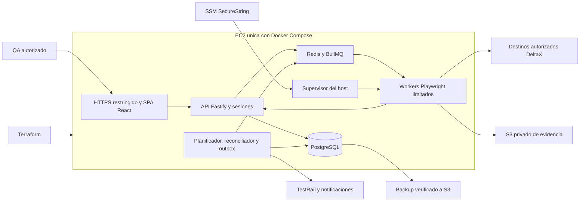

# Arquitectura de Katalyst — un ambiente interno en AWS

Revisión: 6 de noviembre de 2026. Sustituye la propuesta anterior con ECS/SQS/EventBridge/CDK. Base de diseño para implementar: no acredita infraestructura creada ni costos cotizados. La especificación funcional define comportamiento y este documento concreta infraestructura/stack.

## 1. Ambiente y entrega

- Un solo ambiente desplegado de Katalyst: `internal`, en una región y cuenta AWS existentes. Sin copias staging/prod, nuevas cuentas de Organizations o workspace por rama. Desarrollo local y CI no son ambientes AWS adicionales.
- Los destinos de prueba de DeltaX (`environment` en BD) son independientes: Katalyst no aprovisiona un staging de DeltaX. Si solo existe destino productivo, escritura y grabación permanecen bloqueadas hasta disponer de un destino seguro.
- Un único proyecto y entrega final integrada. Los bloques funcionales son hitos internos sin lanzamientos ni aprobaciones del equipo entre ellos; las decisiones externas se resuelven antes de las operaciones dependientes.
- Base económica: una EC2 On-Demand x86_64 con Docker Compose, PostgreSQL y Redis locales; S3 privado para evidencia/backups. Validar costo total y capacidad; no afirmar que es universalmente la opción más barata.
- Un host implica punto único de falla y mantenimiento con interrupciones: se acepta para uso interno, con backup diario, RPO <= 24 h y objetivo RTO <= 4 h probado. Sin promesa de alta disponibilidad.

## 2. Componentes



Proxy/SPA, API, PostgreSQL, Redis, control y runner son servicios separados. Scheduler y outbox comparten paquetes del mismo backend modular; no crear microservicios por pantalla. BD/Redis sin puertos publicados. UI/API del mismo origen y SSE autenticado. Reportes HTML bajo hostname separado y política de aislamiento funcional.

Solo el supervisor del host controla Docker. API y tests no reciben el socket; el supervisor acepta asignaciones tipadas, no comandos arbitrarios. Cada contenedor procesa un shard, con contextos nuevos por test. Listado de tests también se ejecuta aislado, nunca dentro de API. Supervisor y Compose son despliegue de aplicación, no `remote-exec` de Terraform.

## 3. Stack obligatorio

| Área | Tecnología | Regla |
| --- | --- | --- |
| Workspace | TypeScript estricto + pnpm workspaces | Lockfile versionado; sin orquestador adicional hasta justificarlo |
| Frontend | React + Vite | SPA y carga diferida por ruta |
| Navegación | TanStack Router + Zod | Search params tipados/validados |
| Datos remotos | TanStack Query | Única caché cliente del backend |
| Tablas | TanStack Table | Headless; filtros/sort/paginación del servidor |
| Formularios | TanStack Form + Zod | Validación cliente/servidor y errores por campo |
| Estado compartido de UI | TanStack Store cuando haga falta | Stores pequeños; estado simple local con React |
| Virtualización | TanStack Virtual bajo medición | No sustituye paginación del servidor |
| UI | Tailwind CSS + shadcn/ui + Lucide | Identidad DeltaX de capturas; no añadir MUI/DataGrid al panel |
| Gráficos | Recharts | Carga diferida y agregados de servidor |
| Backend | Node LTS vigente + Fastify + Zod + OpenAPI | Sin alternativas NestJS/Drizzle |
| Datos | PostgreSQL + Prisma | Migraciones, índices y pool acotado |
| Cola/horario | Redis + BullMQ Job Schedulers | Outbox, ocurrencias y leases en PostgreSQL |
| Ejecutor | Playwright Test + Chromium Linux x86_64 | Imagen y paquete con versiones compatibles fijadas |
| Grabador local | Electron + React/TypeScript + codegen | Windows 11; aislamiento de contexto, sin Node en renderer ni contenido remoto privilegiado |
| Infraestructura | Terraform + provider AWS | Reemplaza CDK; un root de aplicación y bootstrap de estado |
| Runtime | Docker Compose + Caddy | Assets de SPA en el host; sin CDN inicial |
| Evidencia/backups | S3 privado | Buckets separados de state, evidencia y backups |
| Secretos | SSM Parameter Store SecureString estándar si alcanza | Referencias/permisos mínimos; Secrets Manager solo si se justifica rotación administrada |
| Observabilidad | Pino JSON + métricas de host + CloudWatch acotado | Sin OpenSearch/Timestream; DXMon en PostgreSQL |
| Verificación | Vitest, Testing Library, Playwright, terraform fmt/validate | BD/cola reales para contratos críticos |

Fijar versiones estables compatibles; no instalar beta/RC automáticamente por aparecer en `latest`. La captura de TanStack es un catálogo, no una lista obligatoria de dependencias. No incorporar Start/SSR, DB, AI, Charts, Pacer u otros sin necesidad; gráficas iniciales con Recharts e IA con adaptador backend. Las capturas no incluyen código fuente del prototipo: no asumir que existe frontend reutilizable.

## 4. Capacidad, red y operación

- Ensayar como punto inicial 2 vCPU/8 GiB RAM x86_64, tipo parametrizado. Comparar familias burstable/no burstable y CPU credits. Benchmark con API/BD/Chromium activos; si incumple objetivos, reducir carga o redimensionar con costo documentado.
- `global_browser_concurrency=1` inicialmente, aunque destinos permitan más. Límites CPU/RAM por servicio y concurrencia por usuario/destino. No replicar los cuatro workers del mockup sin medición. Rendimiento reserva ventana exclusiva sin pruebas funcionales simultáneas; detectar contención de host y marcar muestras inválidas.
- Host encendido para cron/colas y regresiones nocturnas. Ahorro mediante frecuencia/horarios explícitos de tests, sin cambiar el criterio de cada 5 min cuando esté habilitado. No Spot para el único host con datos; runner Spot separado sería una ampliación evaluada.
- Sin NAT Gateway: subnet pública, una IPv4/EIP de salida estable, HTTPS entrante limitado a CIDRs corporativos obligatorios o conectividad privada existente. Administración por SSM Session Manager, sin SSH público. TLS DNS-01 con dominio/zona existentes y permiso DNS acotado. No crear VPN nueva. Si se requiere host totalmente privado y no existe conectividad, revisar diseño/costo; no abrir acceso general para evitarlo.
- IMDSv2 obligatorio y bloqueo de IMDS/red administrativa desde tests. Una EC2 no ofrece aislamiento IAM fuerte por contenedor: supervisor confiable entrega solo secretos de cada asignación por montaje temporal en memoria. Worker lee sus credenciales de DeltaX, no panel/TestRail. Sin credenciales AWS duraderas en tests: subir por URL de carga acotada tras validar lease. Solo código revisado; este host no es sandbox de código externo arbitrario.
- EBS gp3 cifrado para datos y disco de sistema separado; preservar datos al reemplazar EC2. Redis AOF + reconciliación desde BD; backup lógico PostgreSQL diario consistente a S3, checksum y restauración probada en contenedor local temporal.
- Reutilizar IdP corporativo si existe; proveedor exacto pendiente, sesión HttpOnly del backend. No crear pool Cognito nuevo por defecto: el login Cognito de DeltaX no determina la identidad del panel. Login propio, si se elige, cumple hash/recuperación/revocación funcionales.

## 5. Terraform de un ambiente

Estructura esperada durante implementación, todavía no creada:

```text
infra/terraform/
  bootstrap/                # bucket de estado; no segundo ambiente de aplicación
  internal/
    backend.tf
    versions.tf
    providers.tf
    main.tf
    variables.tf
    outputs.tf
    terraform.tfvars.example
  README.md
```

- Un estado de aplicación: `katalyst/internal/terraform.tfstate`. Bootstrap crea/protege bucket antes de init; migrar su state inicial a clave administrativa separada, verificar y borrar copias locales. No duplicar workspaces por rama.
- Backend S3 privado/cifrado/versionado, `use_lockfile=true`, IAM mínimo sobre state/lock. Fijar Terraform/provider compatibles y versionar `.terraform.lock.hcl`. Sin DynamoDB para locking nuevo. State, planes y crash logs son sensibles; nunca Git/artefactos públicos.
- Terraform administra VPC/subnet/rutas/Internet Gateway o referencias existentes, SG, EC2/instance profile, EIP, EBS, buckets/lifecycle, IAM, logs/alarma y budget. Reutilizar zona DNS/cuenta aprobadas mediante IDs/ARNs; no destruir recursos compartidos al retirar Katalyst.
- Secretos mediante flujo seguro separado: Terraform conoce nombres/ARNs, no valores. No contraseñas/tokens en `tfvars`, user-data, outputs ni data sources que serialicen secretos al state. `sensitive` oculta presentación, no borra valores del state.
- Variables: región, referencias de red opcionales, dominio/zona, `allowed_cidrs` sin default abierto, tipo/AMI x86_64, discos, retenciones, presupuesto/contactos, prefijos SSM y tags. Sin AWS keys; CI con OIDC/roles temporales y humanos con identidad temporal/SSO.
- Tags: `Project=Katalyst`, `Environment=internal`, `Owner`, `CostCenter`, `ManagedBy=Terraform`. Budget mensual total y avisos de gasto real 50/80/100 % y forecast 100 %; no es un corte automático.
- CI: `terraform fmt -check`, `terraform validate`, plan revisable, controles de cifrado/red y estimación antes del primer apply. Bloqueo backend/pipeline; aplicar solo plan aprobado, no por abrir PR. `prevent_destroy` para bucket state/backups y datos; sin `force_destroy`. Cambios destructivos requieren backup probado y plan explícito.
- Terraform crea infraestructura; pipeline de aplicación construye/despliega imágenes, migra BD y conserva rollback. Actualizar SPA no reprovisiona host. Ejercitar recuperación preservando EIP/volumen/buckets antes de uso real.

## 6. Costos y límites

Antes del primer apply, `docs/costos.md` debe registrar región, fecha, USD, uso esperado y techo acordado. Monto/región siguen pendientes; no inventar precio mensual ni depender de Free Tier/créditos. Cotizar en AWS Pricing Calculator y revisar facturación tras primera semana.

| Partida | Control |
| --- | --- |
| EC2 | Horas, CPU credits si aplican, tamaño ajustado tras benchmark |
| EBS | GiB/snapshots retenidos; sin IOPS extra por defecto |
| IPv4 | Una EIP durante todo el período, incluso con host detenido |
| S3 | GiB, versiones, requests y egreso de evidencia/backups/state |
| Logs/métricas | CloudWatch 14 días y rotación local; sin cuerpos/tokens ni etiquetas de alta cardinalidad |
| DNS/identidad/secretos | Reutilizar recursos; considerar cuotas y cargos reales de SSM estándar |
| IA/canales | Presupuesto propio de IA, límite por usuario/día/solicitud y tamaño de contexto |
| Operación | Tiempo de parches, backup y recuperación del host |

Costo total = cómputo + almacenamiento/backup + IPv4 + requests/egreso + logs/métricas + identidad/DNS/secretos + IA/canales, con cargos aplicables. La base omite NAT Gateway, ALB, API Gateway, ECS/Fargate, RDS/Aurora, ElastiCache, SQS, EventBridge, OpenSearch, Timestream y CloudFront. Añadir alguno requiere necesidad y costo incremental registrados; no mantener dos colas/planificadores.

Retenciones funcionales: evidencia 30 días, muestras 90, resultados/agregados según especificación; backups diarios 7 días. Acotar versiones no actuales de state/backups sin borrar última copia recuperable. No archivar objetos breves en clases con mínimo de permanencia que encarezca eliminación. Videos/trazas solo en fallas/reintentos si seguridad lo permite. Cuotas iniciales: 250 MiB evidencia y 1 GiB temporal por corrida; al superar, detener captura y registrar evidencia incompleta sin ocultar resultado ni borrar BD.

Alarmas: disco 80/90 %, memoria baja, backup > 26 h, outbox vencida, cola atrasada y heartbeat perdido. Supervisión de host y alarma externa de salud EC2: no depender solo del proceso que puede caerse. Budget no reemplaza límites de IA/cuotas. No compromiso de ahorro porcentual hasta comparar uso real.

## 7. Aceptación de infraestructura

- [ ] Un root/estado de aplicación `internal`, sin copias staging/prod o servicios omitidos por defecto.
- [ ] Plan validado, estimación/techo registrados, credenciales temporales y secretos fuera de configuración/state bajo el diseño definido.
- [ ] HTTPS restringido; BD/Redis/SSH/Docker/IMDS inaccesibles desde tests/red no autorizada; entrega de secretos por asignación probada.
- [ ] Un navegador, 5.000 casos y 10 usuarios cumplen objetivos del panel; calidad de monitoreo/capacidad insuficiente visibles.
- [ ] Restauración y reconstrucción de cola probadas; datos/buckets sobreviven reemplazo y retenciones/cuotas funcionan.
- [ ] Reinicio sin duplicaciones ni ráfagas atrasadas; IA respeta presupuesto y evidencia no borra resultados.

## 8. Fuentes oficiales consultadas el 6 de noviembre de 2026

- [TanStack Query: defaults](https://tanstack.com/query/latest/docs/framework/react/guides/important-defaults), [Table: paginación](https://tanstack.com/table/v8/docs/guide/pagination), [Router: search params](https://tanstack.com/router/latest/docs/framework/react/guide/search-params), [Form](https://tanstack.com/form/latest/docs/overview), [Store](https://tanstack.com/store/latest/docs/overview).
- [Terraform: backend S3 y locking](https://developer.hashicorp.com/terraform/language/backend/s3).
- [AWS: VPC/IPv4/NAT](https://aws.amazon.com/vpc/pricing/), [EC2 On-Demand](https://aws.amazon.com/ec2/pricing/on-demand/), [Systems Manager](https://aws.amazon.com/systems-manager/pricing/).

Host único/servicios mínimos son decisiones de diseño para el uso interno esperado; las fuentes describen mecanismos/facturación, no certifican el costo final.
