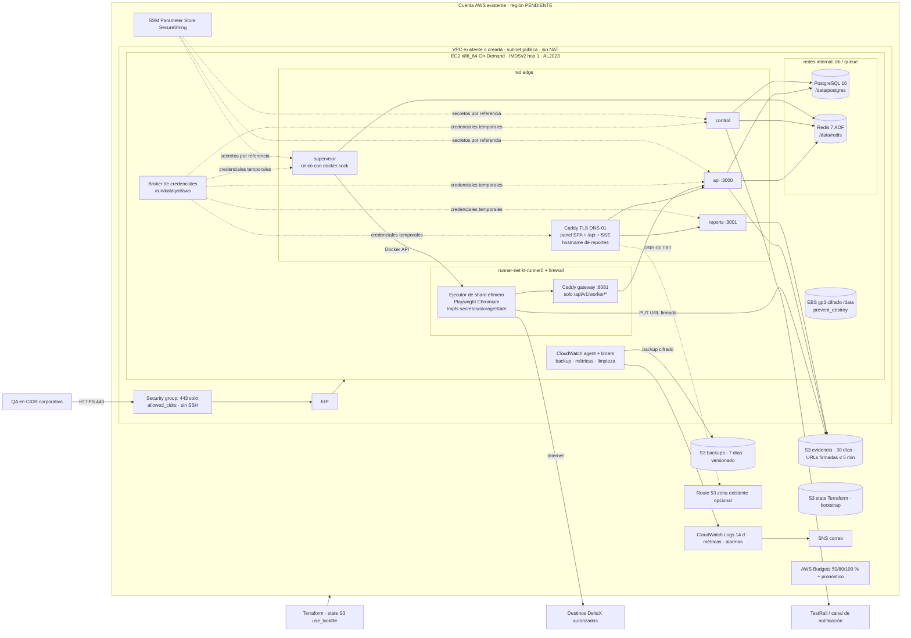

# Infraestructura — Katalyst `internal`

Requisitos: RNF-INF-01/02/03, RNF-SEG-01/03/05, RNF-CON-04, RNF-OBS-02, ESP §4, §13.3, §13.7, §18, ARQ §1–§7.
Código: [`infra/terraform/`](../infra/terraform/README.md) (AWS) y [`deploy/`](../deploy/) (runtime del host).
Operación: [`docs/operacion.md`](operacion.md). Costos: [`docs/costos.md`](costos.md).

## 1. Diagrama

Un solo host implica punto único de falla y mantenimientos con interrupción (ARQ §1): se compensa con backup
diario verificado, recuperación automática de EC2 ante falla de sistema y procedimientos de reemplazo que
preservan EIP, EBS y buckets.

## 2. Mapeo requisito → recurso

| Requisito | Recurso / mecanismo | Archivo |
| --- | --- | --- |
| **RNF-INF-01** un ambiente `internal`, root/estado único | Root `internal`, key `katalyst/internal/terraform.tfstate`, sin workspaces | `infra/terraform/internal/backend.tf` |
| RNF-INF-01 state S3 privado/cifrado/versionado, `use_lockfile`, sin DynamoDB | Bucket de bootstrap con SSE, versionado, PAB, TLS-only, lifecycle de versiones, `prevent_destroy` | `infra/terraform/bootstrap/main.tf` |
| RNF-INF-01 versiones bloqueadas | `required_version ~> 1.17.0`, `aws ~> 6.72.0`, `.terraform.lock.hcl` (linux_amd64 + darwin_arm64) | `versions.tf`, lockfiles |
| RNF-INF-01 secretos fuera de state/config | Solo prefijo SSM y nombres; user-data y outputs sin secretos; valores cargados por stdin fuera de Terraform | `iam.tf`, `compute.tf`, `deploy/scripts/sync-secrets.sh` |
| **RNF-INF-02** estimación/techo, budget, tags, retenciones | `aws_budgets_budget` (real 50/80/100 %, pronóstico 100 %), `default_tags`, lifecycle S3, log group 14 d | `budget.tf`, `providers.tf`, `storage.tf`, `docs/costos.md` |
| **RNF-INF-03** host único sin HA, backups probados, límites, alertas externas, sin Spot | EC2 On-Demand con `recover`, alarmas AWS/EC2 + heartbeat con datos faltantes = alarma, límites CPU/RAM por servicio, backup diario + restauración probada | `compute.tf`, `monitoring.tf`, `deploy/docker-compose.yml`, `deploy/scripts/backup-postgres.sh`, `restore-postgres.sh` |
| **RNF-SEG-05** artefactos privados, URLs firmadas ≤ 5 min | Buckets privados (PAB, BucketOwnerEnforced), política que niega URL firmada con `s3:signatureAge` > 300 000 ms, CORS mínimo GET/HEAD | `storage.tf` |
| RNF-SEG-05 tests sin socket Docker | Solo `supervisor` monta `/var/run/docker.sock`; ejecutores lanzados sin él | `deploy/docker-compose.yml` |
| RNF-SEG-05 tests sin secretos del backend | Ejecutores sin `/run/katalyst/aws`, sin `secrets:` de Compose, sin redes db/queue; solo secreto de su asignación en tmpfs | `docker-compose.yml` (x-katalyst-executor) |
| RNF-SEG-05 tests sin metadatos de nube | IMDSv2 `http_tokens=required`, `hop_limit=1`; firewall `kt-runner0` bloquea 169.254.0.0/16, redes privadas y host | `compute.tf`, `deploy/scripts/runner-net-firewall.sh` |
| RNF-SEG-03 HTTPS restringido | SG 443 solo `allowed_cidrs` (validación rechaza 0.0.0.0/0 y < /8), Caddy TLS DNS-01, sin puerto 80 ni SSH | `security.tf`, `variables.tf`, `deploy/caddy/Caddyfile` |
| ESP §13.7 reportes en origen separado | `reports_hostname` distinto (validación), CSP estricta, cookies del panel host-only | `variables.tf`, `Caddyfile` |
| **RNF-CON-04** backup diario cifrado, 7 días, RPO ≤ 24 h, RTO ≤ 4 h | `pg_dump` en snapshot exportado, GPG asimétrico, SHA-256, bucket versionado con expiración 7 d, alarma > 26 h, restauración en contenedor temporal con conteos | `storage.tf`, `monitoring.tf`, `deploy/scripts/backup-postgres.sh`, `restore-postgres.sh`, `docs/operacion.md` §2–§3 |
| RNF-CON-04 persistencia Redis + reconciliación | Redis AOF `everysec`, `noeviction`, datos en EBS | `deploy/redis/redis.conf` |
| RNF-OBS-02 salud/readiness, métricas | Healthchecks Compose (`/healthz`, archivo de vida), `/readyz` interno, métricas `Katalyst/*` (outbox, cola, leases, backup) | `docker-compose.yml`, `deploy/scripts/publish-metrics.sh`, `monitoring.tf` |
| ESP §18 sin servicios administrados extra | Ningún ALB/API GW/ECS/RDS/ElastiCache/SQS/EventBridge/OpenSearch/Timestream/CloudFront/NAT | `infra/terraform/internal/main.tf` (índice) |
| ESP §18 cuotas por corrida 250 MiB / 1 GiB | Variables de entorno de cuota; `/tmp` del ejecutor 1 GiB | `docker-compose.yml`, `docs/operacion.md` §9 |
| ESP §18 logs 14 días + rotación local | Log group 14 d; Docker json-file 20 MiB × 5; logrotate | `storage.tf`, `templates/user-data.sh.tftpl`, `deploy/host/logrotate-katalyst` |

## 3. Redes del host

| Red Docker | Subred (por defecto) | `internal` | Miembros | Propósito |
| --- | --- | --- | --- | --- |
| `katalyst-edge` | 172.30.0.0/24 | no | caddy, api, control, reports, supervisor | Tráfico Caddy→app y salida a Internet (SSM, S3, TestRail, Git) |
| `katalyst-db` | 172.30.1.0/24 | sí | postgres, api, control, reports, migrate | PostgreSQL sin salida ni puertos publicados |
| `katalyst-queue` | 172.30.3.0/24 | sí | redis, api, control, supervisor | Redis/BullMQ sin salida ni puertos publicados |
| `katalyst-runner-net` (bridge `kt-runner0`) | 172.30.2.0/24 | no | caddy (gateway `worker-gw` 172.30.2.10:8081), ejecutores | Salida a DeltaX; firewall limita destinos |

Las subredes se pueden cambiar en `/etc/katalyst/site.env` si se solapan con `allowed_cidrs`, la VPC o redes
corporativas (el tráfico de retorno a un cliente en 172.30.0.0/16 se enrutaría al bridge).

Firewall de `kt-runner0` (`runner-net-firewall.sh`, cadenas `KATALYST-RUNNER-FWD` desde `DOCKER-USER` y
`KATALYST-RUNNER-IN` desde `INPUT`): permite respuestas y `worker-gw:8081`; bloquea tráfico entre ejecutores,
`169.254.0.0/16`, `10/8`, `172.16/12`, `192.168/16`, `100.64/10`, `127/8`, multicast y cualquier conexión al
host; excepciones privadas solo con `RUNNER_PRIVATE_ALLOW_CIDRS` registradas. La sonda de
`smoke-test.sh --host` verifica IMDS, BD/Redis, host, panel, socket Docker y credenciales AWS desde la red.

## 4. Identidad y secretos

- **Rol del host** (`iam.tf`): Session Manager/Run Command sin `ssm:GetParameter*` global; lectura de SSM solo
  bajo `ssm_parameter_prefix`; S3 evidencia (RW + borrado para limpieza) y backups (sin borrado, además negado
  por bucket policy); `PutMetricData` solo en `CWAgent`/`Katalyst`; logs solo en su log group; Route 53 solo
  TXT `_acme-challenge` de los dos hostnames (si hay zona).
- **IMDSv2 hop limit 1**: los contenedores no llegan a IMDS. Servicios confiables (caddy, api, control, reports,
  supervisor) leen credenciales temporales del broker (`credential_process` en `/run/katalyst/aws`, tmpfs). Una
  EC2 no aísla IAM por contenedor (ARQ §4): todos los servicios confiables comparten el rol.
- **SSM** (valores cargados fuera de Terraform):

| Parámetro | Tipo | Lector |
| --- | --- | --- |
| `
/host/postgres_password` | SecureString | `sync-secrets.sh` (host) |
| `
/host/redis_password` | SecureString | `sync-secrets.sh` (host) |
| `
/backup/gpg_public_key` | String | `backup-postgres.sh` (host) |
| `
/app/...` (sesión, TestRail, token del supervisor, IA, token DNS no-Route 53) | SecureString | app vía `SecretProvider=ssm` |
| `
/test-users/<ambiente>/<label>` | SecureString | supervisor (por asignación) |

`
` = `ssm_parameter_prefix` (por defecto `/katalyst/internal`).

## 5. Contratos con la aplicación (para apps/api y apps/runner)

| Contrato | Detalle |
| --- | --- |
| Secretos de conexión | `DATABASE_URL_FILE`, `REDIS_URL_FILE` (el entrypoint de la imagen los exporta como `DATABASE_URL`/`REDIS_URL`) |
| Pool PostgreSQL | `DATABASE_POOL_MAX`: api 10, control 6, reports 3 (total ≤ 20, RNF-OPT-05) |
| Salud | `/healthz` (api :3000, reports :3001) sin secretos; `/readyz` refleja BD/cola; control y supervisor actualizan el mtime de `KATALYST_HEALTH_FILE` (`/tmp/health/alive`) en cada ciclo (≤ 15 s) |
| Métricas | `/metrics` Prometheus en loopback de `api` con `katalyst_outbox_overdue`, `katalyst_queue_oldest_waiting_seconds`, `katalyst_worker_leases_expired_recent` (sin etiquetas de alta cardinalidad) |
| Cookies del panel | `__Host-` prefijadas, HttpOnly, Secure, SameSite, sin atributo `Domain` (nunca enviadas al hostname de reportes) |
| Reportes | `reports` autoriza con ticket propio de un solo uso ≤ 5 min (no cookies del panel; sin tokens persistentes en URL) |
| Ejecutor | Lanzado por el supervisor con las opciones de `x-katalyst-executor`; etiquetas `katalyst.role=executor`, `katalyst.run`, `katalyst.shard`; habla solo con `KATALYST_WORKER_API_URL=http://worker-gw:8081`; `log-driver none` |
| Rutas compartidas | Secretos de asignación `/run/katalyst/shards/<shardId>/secrets` (tmpfs host); temporales `/data/runner/runs/<runId>/<shardId>`; checkouts `/data/runner/checkouts/<commit>` (touch al usar) |
| Cuotas | `KATALYST_RUN_EVIDENCE_QUOTA_BYTES=262144000`, `KATALYST_RUN_TMP_QUOTA_BYTES=1073741824` |
| Versiones | `KATALYST_PLAYWRIGHT_VERSION` en la imagen del ejecutor = `@playwright/test` de qa-tests; mismatch = error de infraestructura |

## 6. No aprovisionado por diseño

NAT Gateway, ALB, API Gateway, ECS/Fargate, RDS/Aurora, ElastiCache, SQS, EventBridge, OpenSearch, Timestream,
CloudFront/CDN, VPN, Cognito, Secrets Manager, ECR, cuentas/ambientes adicionales. Cualquier ampliación requiere
necesidad y costo incremental registrados (ESP §18).
